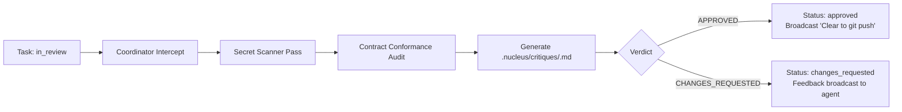

# ⚛️ Nucleus — Multiplayer AI Engineering Room

[](https://nodejs.org/)
[](https://www.typescriptlang.org/)
[](packages/cli/src/system-audit.test.ts)
[](LICENSE)
[](docs/multiplayer-room-architecture.md)

> **Turn AI-assisted software engineering from an isolated, single-player silo into a real-time, multi-terminal collaborative engineering room.**

**Nucleus** enables an Initiator (Tech Lead / Architect) and Contributors (Frontend, Backend, Database engineers) to build full-stack features simultaneously across isolated code lanes against living, locked contracts. Each engineer drives their own AI coding agent (Claude Code, Google Antigravity, Cursor, Aider) under their own subscription and credentials, while Nucleus provides sub-second live diff streaming, cross-lane shadow mirrors, and automated critique verification.

---

## 📑 Table of Contents

- [The Core Problem](#-the-core-problem)
- [How Nucleus Works (The Pure Pull Model)](#-how-nucleus-works-the-pure-pull-model)
- [Core Architecture & Capabilities](#-core-architecture--capabilities)
- [How LLM Agents Auto-Discover Peer Code (`.nucleus/PEERS.md`)](#-how-llm-agents-auto-discover-peer-code-nucleuspeersmd)
- [The Automated Critique Gate](#-the-automated-critique-gate)
- [Quick Start Guide](#-quick-start-guide)
- [CLI Reference](#-cli-reference)
- [Project Layout](#-project-layout)
- [Engineering Protocols & Verification](#-engineering-protocols--verification)
- [Roadmap & MVP Status](#-roadmap--mvp-status)

---

## ⚠️ The Core Problem

Autonomous AI coding agents (Claude Code, Antigravity, Devin, Cursor) have revolutionized development, but working with them in isolation hits four hard walls:

1. **Context Rot & Hallucinations**: When a single AI session holds an entire full-stack app (schema, APIs, frontend UI, tests), reasoning degrades and cross-file hallucinations skyrocket.
2. **The "Single-Player" Silo**: Multiple developers on a team using AI independently create divergent API schemas and database types, causing massive Git merge conflicts and staging bugs.
3. **Provider Quota & Account Ceilings**: Running multiple agents on one developer subscription burns rate limits and context budgets in hours.
4. **Credential & Security Risks**: Central orchestration platforms often require sharing API keys or proxying enterprise source code through third-party servers.

Nucleus solves this by transforming software engineering into a **structured, live multiplayer room** operating on the local network.

---

## 🏗️ How Nucleus Works (The Pure Pull Model)

```
┌────────────────────────────── INITIATOR MACHINE (CENTER) ─────────────────────────────┐
│                                                                                       │
│ ┌───────────────────┐ ┌───────────────────┐ ┌───────────────────────────────────────┐ │
│ │ ROOM COORDINATOR  │ │ CRITIQUE GATE     │ │ INITIATOR'S OWN NODE DAEMON & AGY     │ │
│ │ (session state,   │ │ (secret scanner,  │ │ (the Initiator also builds in a lane, │ │
│ │  contract store,  │ │  contract audit,  │ │  reviews, and orchestrates)          │ │
│ │  live diff feed,  │ │  critique .md     │ └───────────────────────────────────────┘ │
│ │  task board, log) │ │  generator)       │                                           │
│ └─────────┬─────────┘ └───────────────────┘                                           │
└───────────┼───────────────────────────────────────────────────────────────────────────┘
            │ WebSocket (Local Wi-Fi / Tunnel, per-room token auth, signed JSON envelopes)
            │
   ┌────────┴─────────────┬──────────────────────────┬────────────────────────┐
   │                      │                          │                        │
┌──▼─────────────────┐ ┌──▼─────────────────┐     ┌──▼─────────────────┐   ┌──▼─────────────────┐
│ FRONTEND LANE      │ │ DATABASE LANE      │ ... │ BACKEND LANE       │   │ LIVE OBSERVER / UI │
│ (own laptop,       │ │ (own laptop,       │     │ (own laptop,       │   │ (TUI or Web feed:  │
│  own agent & keys, │ │  own agent & keys, │     │  own agent & keys, │   │  live diffs, code  │
│  `sphere-node`)    │ │  `sphere-node`)    │     │  `sphere-node`)    │   │  activity, locks)  │
└────────────────────┘ └────────────────────┘     └────────────────────┘   └────────────────────┘
```

### The "Zero Process Hijacking" Rule
Nucleus **never injects commands or keystrokes into a contributor's running AI terminal**. External steering violates provider terms of service (Anthropic, Google) and triggers abuse telemetry.

Instead, Nucleus uses an unprivileged, file-based **Pure Pull Model**:
- **Zero Credential Sharing**: Developers use their own local AI tool and subscriptions. No API keys ever cross the network.
- **Filesystem-Driven Coordination**: Coordination happens strictly via files: `.nucleus/tasks.json`, `.nucleus/PEERS.md`, `.nucleus/shadows/`, and `CONTRACT/api.md`.
- **Git Remains Ground Truth**: Nucleus never auto-pushes to Git without contributor verification.

---

## ⚡ Core Architecture & Capabilities

1. **Sub-Millisecond Live Diff Streaming**: As an engineer or agent types, local file changes are diff-compressed and streamed over WebSocket (>1,100 msgs/sec benchmarked, <7ms fanout latency).
2. **Cross-Lane Shadow Mirrors (`.nucleus/shadows/<lane>/`)**: Frontend agents inspect live, uncommitted backend code directly on disk without waiting for Git commits or PRs.
3. **Workspace Jail & Non-Bypassable Ignores**: Strict sandboxing prevents agents from modifying files outside their lane, with non-bypassable ignore lists and binary null-byte filters.
4. **Living Contracts (`CONTRACT/`)**: Shared schema definitions (OpenAPI, Prisma, event formats) are guarded by distributed lease mutexes (15s TTL auto-recovery).
5. **Detailed Spec Files & Design URLs**: Tasks support `spec_file` (e.g. `CONTRACT/specs/...`) and `spec_url` (Figma / PRD links), automatically injected into `.nucleus/PEERS.md` so agents read full specs before writing code.
6. **Bidirectional Task Synchronization**: Changes made to `.nucleus/tasks.json` by developers or AI agents are observed in real time and broadcasted over the coordinator WebSocket.
7. **Zero-Config Public Tunneling (`--tunnel`)**: Connect remote teammates anywhere in the world via automatic Cloudflare Tunnel fallback without router configuration or port forwarding.
8. **Automated Task Board Archiving (`--clean`)**: Completed and reviewed tasks are archived to `.nucleus/tasks_archive.json` to keep active context clean and reduce LLM token overhead.
9. **Secret Scanner & Guardrails**: Automatic detection blocks AWS keys, Stripe tokens, and private RSA keys before code is accepted.

---

## 🤖 How LLM Agents Auto-Discover Peer Code (`.nucleus/PEERS.md`)

AI coding agents (Claude Code, Google Antigravity, Cursor, Aider) read files natively. Nucleus dynamically maintains **`.nucleus/PEERS.md`** in real time:

```markdown
## Active Room Peers & Live Shadow Directory

| Lane | Node ID | Status | Active File / Focus | Live Shadow Mirror Path |
| :--- | :--- | :--- | :--- | :--- |
| `backend` | `node-be-9a` | active | `server/src/modules/users/profile.controller.js` | `.nucleus/shadows/backend/` |
| `frontend` | `node-fe-3c` | active | `client/src/features/profile/ProfileSettings.jsx` | `.nucleus/shadows/frontend/` |
```

When the frontend agent is instructed to *"Build the Profile Settings UI"*:
1. It reads `.nucleus/PEERS.md` and sees the backend engineer is editing `profile.controller.js`.
2. It inspects `.nucleus/shadows/backend/server/src/modules/users/profile.controller.js`.
3. It generates the matching client hook and UI component matching the **exact backend response envelope** with zero guesswork.

---

## 🛡️ The Automated Critique Gate

When any contributor agent marks a task status as `"in_review"`:



- **Verdict:** Writes a formal report to `.nucleus/critiques/<task-id>.md`.
- **Approval:** When verified, the contributor daemon alerts:
  > `🎉 Task [id] was APPROVED by Critique Gate! Ready to git commit and push to remote!`

---

## 🚀 Quick Start Guide

### 1. Installation
In the Nucleus repository root:
```bash
npm install
npm run build
npm link
```

### 2. Host a Room (Tech Lead / Initiator)
```powershell
# Open room locally on local network / Wi-Fi
nucleus init --port 9876

# Or host with zero-config public internet tunnel for remote teammates
nucleus init --tunnel
```
*(The host prints your local Wi-Fi and public tunnel URLs and automatically initializes `.nucleus/tasks.json` and `CONTRACT/api.md`.)*

### 3. Invite Team Members
In another terminal, issue single-use tokens for assigned lanes:
```powershell
nucleus invite --lane frontend
nucleus invite --lane backend
nucleus invite --lane database
```

### 4. Join a Room (Contributor Laptop)
```powershell
# Connect to local Wi-Fi host
nucleus join --url ws://<HOST_IP>:9876 --token <TOKEN> --lane frontend --name "Harsh"

# Or connect to public internet tunnel host
nucleus join --url wss://<TUNNEL_URL>.trycloudflare.com --token <TOKEN> --lane frontend --name "Harsh"
```

Once connected, run your local AI agent (Claude Code, Antigravity, Aider) in the workspace and prompt it to pick up tasks from `.nucleus/tasks.json`.

---

## 💻 CLI Reference

| Command | Options | Description |
| :--- | :--- | :--- |
| `nucleus init` | `-p, --port <port>`<br/>`-r, --room <name>`<br/>`--tunnel` | Open and host a multiplayer room (with optional public internet tunnel) |
| `nucleus join` | `-u, --url <url>`<br/>`-t, --token <token>`<br/>`-l, --lane <lane>`<br/>`-n, --name <name>` | Connect local workspace to an active room |
| `nucleus invite` | `-l, --lane <lane>` | Generate a secure single-use join token |
| `nucleus tasks` | `-c, --clean`<br/>`-a, --archived`<br/>`-l, --lane <lane>` | View task board, archive approved tasks (`--clean`), or view past work (`--archived`) |
| `nucleus claim` | `<task_id>` | Claim an available task for your lane (lane-enforced) |
| `nucleus release` | `<task_id>` | Release/unclaim a claimed task back to unassigned |
| `nucleus status` | *none* | Show active room peers, connected lanes, and locks |

---

## 📁 Project Layout

```text
nucleus/
├── packages/
│   ├── protocol/          # Wire contracts & Zod message envelopes
│   ├── coordinator/       # Room host, lease locks, task state machine & Critique Gate
│   ├── daemon/            # sphere-node (file watcher, live diff stream & shadow manager)
│   ├── critic/            # Automated critique engine, SecretScanner & contract auditor
│   └── cli/               # User-facing CLI (nucleus init, join, invite, tasks)
├── .nucleus/              # Runtime coordination directory (auto-managed)
│   ├── PEERS.md           # Live peer roster & active file index (read by agents)
│   ├── tasks.json         # Shared room task board
│   ├── tasks_archive.json # Historical archive of completed and approved tasks
│   ├── session.json       # Local node identity and active lane state
│   ├── shadows/           # Real-time uncommitted file mirrors from peer lanes
│   └── critiques/         # Formal verification and audit reports
├── CONTRACT/              # The Living Blueprint (frozen endpoints & schemas)
│   ├── api.md             # API specifications and payload envelopes
│   └── specs/             # Detailed PRD / Figma specification handoff documents
└── docs/                  # Architecture specifications & deep system audits
```

---

## 🧪 Engineering Protocols & Verification

Nucleus is built under strict distributed systems standards:
- **Comprehensive Test Suite:** 19 test suites and **73 tests passing** (Vitest).
- **Stress & Throughput Benchmarks:** Validated under 200 diff bursts at >1,100 messages/sec with sub-7ms broadcast latency.
- **Jailbreak Defense:** 100% path-traversal prevention (`../` and symlink escapes blocked).
- **Concurrency Safety:** Multi-node mutex tests verify 1 lease winner, 0 race conditions, and automatic lease recovery on disconnect.

Run tests:
```bash
npm test
```

---

## 🗺️ Roadmap & MVP Status

For full details, see [ROADMAP_AND_MVP_STATUS.md](ROADMAP_AND_MVP_STATUS.md).

- [x] **Milestone 1:** Zod wire protocol, heartbeat monitor, and JSONL event log replay.
- [x] **Milestone 2:** Living Contract synchronization and distributed 15s lease locks.
- [x] **Milestone 3:** Real-time WIP diff streaming and `.nucleus/PEERS.md` context injection.
- [x] **Milestone 4:** Task state machine and Automated Critique Gate review pipeline.
- [x] **Milestone 5:** Developer CLI (`nucleus init`, `join`, `invite`).
- [x] **Final MVP Polish:** Exponential backoff auto-reconnect, zero-config `--tunnel` flag, task cleanup (`--clean`), spec file support, and hardened watcher ignores.
- [ ] **Beyond MVP (v1.x):** Ephemeral Docker test runner sidecars, multi-repo support, and WebRTC P2P mesh.
- [ ] **Beyond MVP (v1.x):** Ephemeral Docker test runner sidecars, multi-repo support, and WebRTC P2P mesh.
