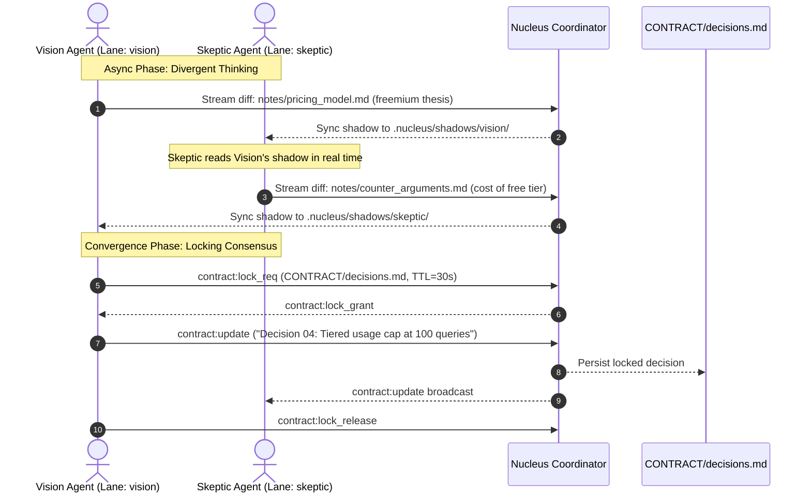

# Generalized Multi-Agent Consensus & Room Presets Architecture

**Document Type:** Architectural Proposal & Specification  
**Status:** Proposal / Approved Design  
**Date:** 2026-11-24  

---

## 1. Executive Summary

Nucleus was originally conceived as a multiplayer orchestration room for three-tier software engineering (`frontend`, `backend`, `database`/`qa`). However, the fundamental mechanics of Nucleus—**distributed lease locks, living contracts, live shadow diff streaming, lane-isolated workspace jails, and autonomous critique gates**—are domain-agnostic. 

Nucleus is an **asynchronous multi-agent consensus and coordination engine operating over a shared filesystem under the Pure Pull Model**.

This specification formalizes two major extensions:
1. **Dynamic Multi-Contributor Lane Scaling:** Scaling beyond 4 people, supporting sub-lanes and multiple peers operating within the same functional domain.
2. **Room Presets & Modes:** Expanding Nucleus from code repositories to **brainstorming, product planning, architecture design, and academic/market research**.

---

## 2. Core Problem: The Single-LLM Bottleneck Beyond Code

When using LLMs for complex, non-coding workflows (e.g., product strategy, system design, market evaluation):
1. **Context Smear & Loss of Perspective:** A single AI session forced to brainstorm user personas, technical trade-offs, financial modeling, and risk factors produces homogenized, agreeable, and shallow output.
2. **Lack of Constructive Tension:** High-quality strategy requires adversarial perspectives (e.g., an ambitious product visionary vs. an aggressive skeptic/red team). In a single prompt thread, the LLM continuously agrees with its own previous assertions.
3. **Chat-Room Chaos:** Traditional multi-agent chat environments (group chat prompts, Slack bots) flood the context window with repetitive conversational filler ("I agree with @researcher, let's also consider..."), causing rapid token exhaustion and hallucination.
4. **No Deterministic Consensus:** Chats drift without freezing agreed decisions.

---

## 3. The Generalized Consensus Model

In the generalized Nucleus model, the core abstractions map cleanly across any knowledge domain:

| Nucleus Abstraction | Software Engineering Mode (`code`) | Brainstorming & Strategy Mode (`brainstorm`) | Research & Investigation Mode (`research`) |
| :--- | :--- | :--- | :--- |
| **Living Contract (`CONTRACT/`)** | `api.md`, `schema.prisma` (routes, payloads, types) | `PRD.md`, `decision_record.md` (the core thesis, target persona, scope freeze) | `thesis.md`, `methodology.md` (hypotheses, empirical criteria) |
| **Lanes (`--lane`)** | `frontend`, `backend`, `database`, `devops` | `product-vision`, `skeptic-redteam`, `market-intel`, `architect` | `literature-review`, `data-analyst`, `adversarial-peer`, `synthesizer` |
| **Shadows (`.nucleus/shadows/`)** | Live uncommitted code diffs | Real-time working notes, user journey drafts, competitor matrices | Raw data tables, citation notes, draft proofs |
| **Shared Task Board (`tasks.json`)** | "Build ping endpoint", "Implement auth UI" | "Stress-test unit economics", "Draft user interview script", "Audit compliance" | "Scrape ArXiv abstracts", "Run regression model", "Rebut critique #2" |
| **Critique Gate** | Secret scanner, linter, schema adherence check | **Coherence Gate**: Consistency with frozen PRD decisions, fact-checking audit | **Methodology Gate**: Statistical significance, citation verification |

---

## 4. Multi-Person & Sub-Lane Scaling

To scale rooms to teams of 5, 10, or 20+ contributors and AI agents:

### 4.1. Arbitrary Custom Lanes
Lanes are no longer restricted to hardcoded presets. Any lane identifier is valid:
```powershell
nucleus invite --lane mobile-ios
nucleus invite --lane devops-k8s
nucleus invite --lane security-audit
```

### 4.2. Sub-Lanes and Multi-Agent Parallelism
When multiple engineers or agents work within the same broad tier (e.g., multiple backend engineers):
- **Hierarchical Lanes:** `--lane backend:billing`, `--lane backend:auth`, `--lane backend:catalog`.
- **Shared Lane Pools:** Multiple contributors connect with `--lane backend` but unique handles (`--name Alice`, `--name Bob`). The coordinator permits both to claim independent tasks matching `lane: "backend"`.
- **Shadow Namespace Isolation:** `.nucleus/shadows/` structures by lane and handle:
  ```text
  .nucleus/shadows/
  ├── backend-alice/
  │   └── server/src/billing/
  └── backend-bob/
      └── server/src/auth/
  ```

---

## 5. Room Presets & CLI Specification

### 5.1. Initializing with Room Presets (`nucleus init --preset <name>`)

```powershell
# 1. Engineering / Monorepo Mode (Default)
nucleus init --preset engineering

# 2. Product Brainstorming & Strategy Mode
nucleus init --preset brainstorm

# 3. Deep Research & Analysis Mode
nucleus init --preset research

# 4. Custom Preset Definition
nucleus init --preset custom --lanes "vision,skeptic,finance,tech" --contract "PRD.md"
```

### 5.2. Preset Templates

#### Preset A: `engineering` (Default)
- **Default Lanes:** `frontend`, `backend`, `database`, `devops`, `qa`
- **Contract Scaffold:** `CONTRACT/api.md` (OpenAPI-style routes, request/response envelopes)
- **Critique Gate:** Secret scanning, contract conformance audit, file jail.

#### Preset B: `brainstorm`
- **Default Lanes:**
  - `vision`: Defines value proposition, user stories, and target audience.
  - `skeptic`: Red-teams assumptions, finds edge cases, highlights failure modes.
  - `market`: Researches competitive moat, alternative solutions, and pricing benchmarks.
  - `systems`: Evaluates technical feasibility and scaling constraints.
- **Contract Scaffold:** `CONTRACT/PRD.md` and `CONTRACT/decisions.md` (Architecture Decision Records)
- **Critique Gate:** Coherence review (ensures claims in drafts do not contradict frozen decisions in `CONTRACT/decisions.md`).

#### Preset C: `research`
- **Default Lanes:**
  - `literature`: Surveys state-of-the-art papers, patents, and existing implementations.
  - `methodology`: Formulates empirical test criteria, metrics, and dataset requirements.
  - `synthesis`: Drafts executive abstracts and cohesive research reports.
  - `adversary`: Identifies bias, p-hacking risks, and unsupported causal assertions.
- **Contract Scaffold:** `CONTRACT/thesis.md` and `CONTRACT/metrics.md`
- **Critique Gate:** Citation integrity, formal schema validation of data outputs.

---

## 6. Distributed Consensus Workflow for Brainstorming



---

## 7. Immediate Implementation Roadmap

1. **Phase 1: Dynamic `--lanes` CLI Argument (Quick Win):**
   - Add `--lanes <comma-separated>` flag to `nucleus init`.
   - Allow any lane string in `nucleus invite --lane <name>` without validation errors.
2. **Phase 2: Preset Scaffold Engine:**
   - Introduce `--preset <engineering|brainstorm|research>` to `nucleus init`.
   - Auto-populate `CONTRACT/` and initial task suggestions based on the chosen preset.
3. **Phase 3: Multi-Node Same-Lane Support:**
   - Namespace shadow mirrors as `.nucleus/shadows/<lane>-<nodeId>/` when multiple peers share a lane.
