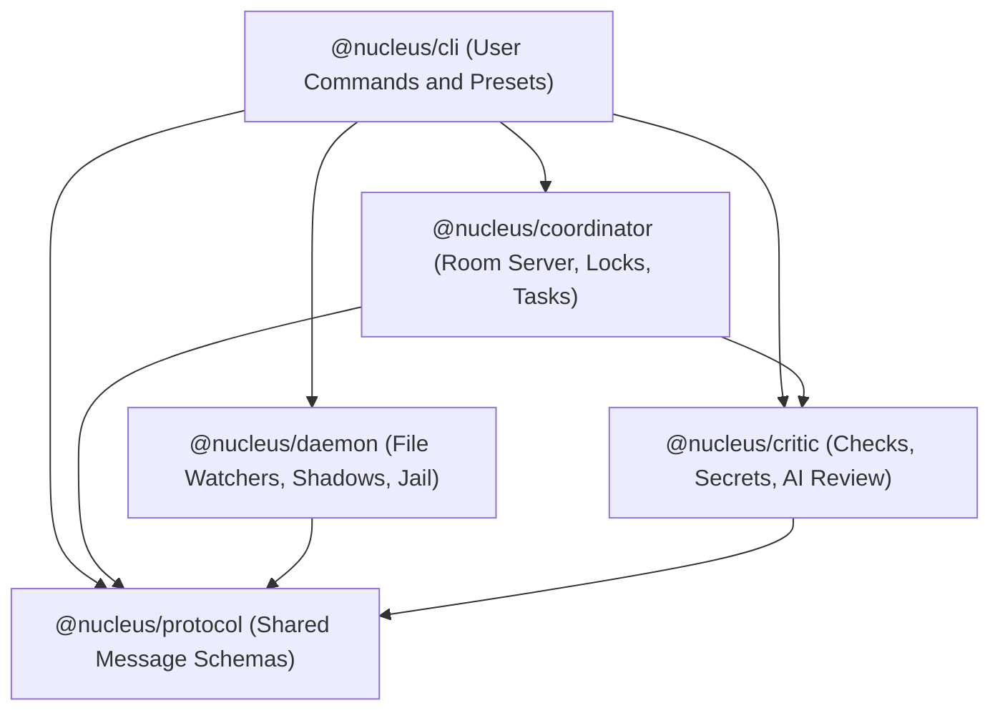
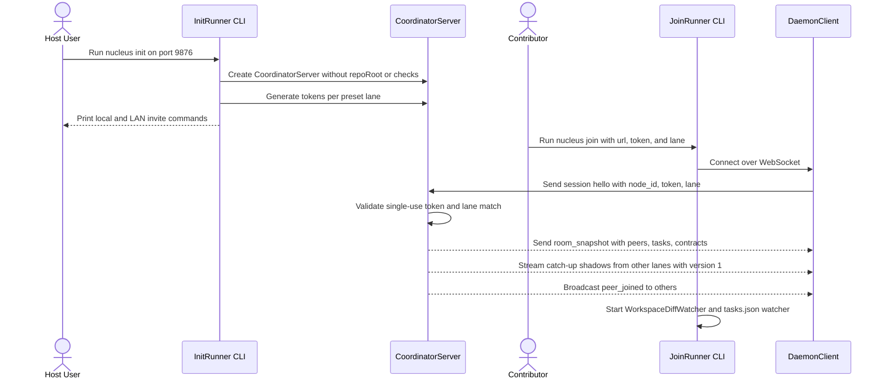
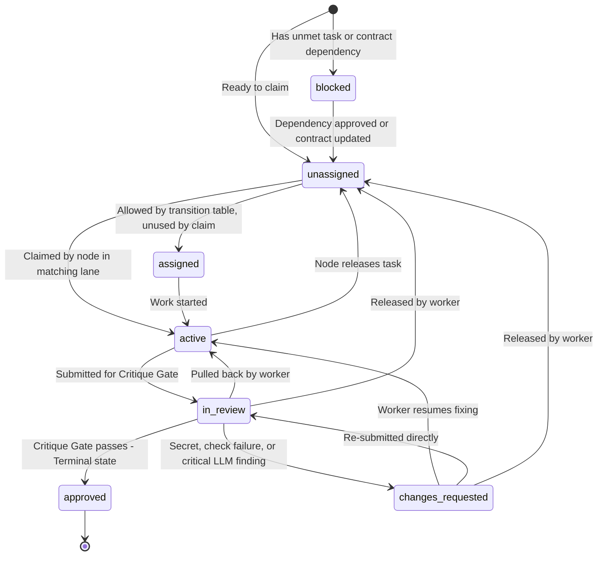
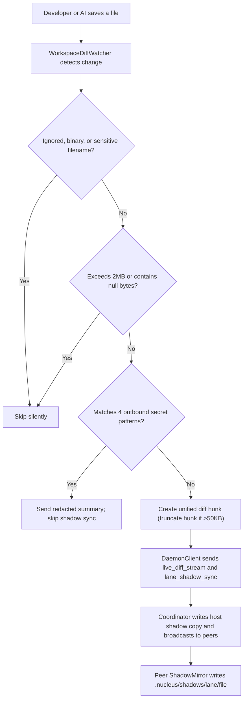

# Nucleus — Complete System Blueprint & Honest Engineering Audit

> **Scope:** Plain-language, file-by-file technical guide to the entire Nucleus codebase (`packages/protocol`, `packages/coordinator`, `packages/daemon`, `packages/critic`, `packages/cli`, root configuration, and all 22 test suites), paired with an unvarnished audit of **what works, what is broken or half-wired, and how current code differs from the original Nucleus vision.**

---

## Documentation Map

| Guide | What It Covers |
| :--- | :--- |
| **[This Overview](./README.md)** | Big-picture mental model, **Core Idea vs. Current Reality**, end-to-end diagrams, package map, and root config files |
| **[Protocol Package](./protocol.md)** | `packages/protocol` — Shared message envelopes, schemas, and signing helpers (7 source files) |
| **[Coordinator Package](./coordinator.md)** | `packages/coordinator` — Room server, leases, task state machine, event log, invites, and contracts (9 source files) |
| **[Daemon Package](./daemon.md)** | `packages/daemon` — Client connection, reconnects, workspace jail, file watchers, diffs, and shadow mirrors (10 source files) |
| **[Critic Package](./critic.md)** | `packages/critic` — Secret scanner, Git worktrees, deterministic command runner, LLM providers, and report formatter (10 source files) |
| **[CLI Package](./cli.md)** | `packages/cli` — Entrypoint script, argument parser, `init`/`join`/`tasks` runners, presets, and tunnels (12 source files) |
| **[Tests & Runtime Audit](./tests-and-verification.md)** | All 22 Vitest suites (113 passing tests), what is genuinely tested vs. mocked, and live dogfooding log evidence |

---

## 1. What Nucleus Is (In Simple Language)

Imagine two or three developers—each sitting at their own laptop with their own AI coding assistant (like Claude Code, Antigravity, Cursor, or Aider)—trying to build one app together at the same time.

Normally, if one person builds the backend and another builds the frontend:
- They wait hours or days for Git commits and pull requests before seeing each other's code.
- The backend names a field `accessToken` while the frontend expects `token`, causing silent bugs and merge headaches.
- Sharing one central AI server requires sending API keys over the internet or letting a remote tool hijack someone's terminal (which violates AI provider Terms of Service).

**Nucleus tries to solve this with a "Pure Pull Model":**
Instead of controlling anyone's AI terminal or sharing API keys, Nucleus runs a small background helper on each laptop that keeps **five local folders/files** synchronized in real time over WebSockets:
1. **`CONTRACT/`** — Shared agreement files (like API shapes or rules) protected by short 15-second edit locks.
2. **`.nucleus/tasks.json`** — The shared to-do board showing who owns which task and what is blocked.
3. **`.nucleus/PEERS.md`** — A live status sheet written to disk so local AI agents automatically know who is online, what file they are touching, and where to inspect their code.
4. **`.nucleus/shadows/<lane>/`** — Read-only live copies of teammates' uncommitted code so a frontend AI can read backend routes while they are still being typed.
5. **`.nucleus/critiques/<task-id>.md`** — Review reports telling an engineer (and their AI) whether their task passed checks or needs fixes.

---

## 2. How the Packages Fit Together

Nucleus is split into five TypeScript packages inside `packages/`, organized in strict layers so lower layers never depend on upper ones.



### Who Runs What on Which Machine?

```mermaid
flowchart LR
    subgraph HostMachine["Host / Initiator Machine"]
        initCmd["nucleus init"]
        coordSrv["Coordinator Server (WebSocket Hub)"]
        criticEng["Critic Engine (Reviews in_review tasks)"]
        hostFiles["Host Disk: CONTRACT/, tasks.json, shadows/, critiques/, logs/"]
        initCmd --> coordSrv
        coordSrv --> criticEng
        coordSrv --> hostFiles
    end

    subgraph DevA["Backend Laptop"]
        joinA["nucleus join --lane backend"]
        watchA["File Watcher and Shadow Sender"]
        jailA["Workspace Jail"]
        agentA["Local AI CLI (Claude / Agy / Cursor)"]
        joinA --> watchA
        watchA --> jailA
        agentA -. reads and edits files .-> jailA
    end

    subgraph DevB["Frontend Laptop"]
        joinB["nucleus join --lane frontend"]
        mirrorB["Shadow Mirror and PEERS.md Writer"]
        jailB["Workspace Jail"]
        agentB["Local AI CLI (Claude / Agy / Cursor)"]
        joinB --> mirrorB
        mirrorB --> jailB
        agentB -. reads shadows and PEERS.md .-> jailB
    end

    watchA -- "WebSocket: diffs, shadows, task updates" --> coordSrv
    coordSrv -- "WebSocket: snapshots, contracts, peer shadows" --> mirrorB
```

---

## 3. Core Idea vs. Current Reality (Where Nucleus Differs Today)

Based on reading the original design blueprints (`docs/multiplayer-ai-engineering-analysis (1).md`, `docs/multiplayer-room-architecture.md`, `docs/technical-and-conceptual-blueprint.md`, `docs/generalized-consensus-and-room-presets.md`, `docs/real-world-scenarios-and-edge-cases.md`, and `README.md`) and comparing them line-by-line against the actual source code, **many foundational pieces are built, but several critical bridges between them are missing or half-connected.**

| Area | Original Core Idea (Blueprint & Docs) | Current Code Reality (What Actually Happens) | Impact |
| :--- | :--- | :--- | :--- |
| **Critique Gate Execution** | Runs build, lint, and tests inside an isolated Git worktree, then runs an AI architectural review against `CONTRACT/`. | `InitRunner` (`nucleus init`) **never passes** the repo path, worktree folder, or test commands to `CoordinatorServer`. Without `GEMINI_API_KEY` or `ANTHROPIC_API_KEY`, the critic falls back to simple regex checks. | In real CLI usage, tasks marked `in_review` can be auto-approved in milliseconds (observed in `.nucleus/logs/nucleus.jsonl`: 3ms) with zero tests run and zero contract checking. |
| **Critique Delivery** | Review findings written to `.nucleus/critiques/<task>.md` are synced back to the contributor's laptop for their AI to read. | `CoordinatorServer` writes the critique file **only on the host machine**. No message sends critique files back to remote contributors, even though `JoinRunner` prints "Inspect `.nucleus/critiques/<id>.md`". | Remote contributors get told a task was rejected, but never receive the report explaining why. |
| **LLM Critic Failure Safety** | Critique Gate blocks faulty work until fixed. | If Gemini or Anthropic returns an HTTP error, rate limit, or invalid JSON, the provider emits a `warning` (not `critical`), so the pipeline **still marks the task `approved`**. | API outages or bad responses silently wave unreviewed code straight through. |
| **Contract Editing Loop** | Any peer can lock a contract file, edit it locally, release it, and broadcast updates to affected lanes. | `ContractWatcher` exists in `@nucleus/daemon`, **but `JoinRunner` never starts it**. `DaemonClient` also leaves `contractVersion` stuck at `0`, and `CoordinatorServer` broadcasts updates to everyone instead of filtering affected sections/lanes. | Editing `CONTRACT/api.md` on a contributor machine does not automatically lock or sync changes to the room. |
| **Transport & Envelope Security** | Encrypted TLS 1.3 WebSockets plus HMAC/Ed25519 message signatures (`sig`) on every envelope. | `CoordinatorServer` runs plain unencrypted `ws://` (encryption only exists externally via `--tunnel`). Signing helpers exist in `@nucleus/protocol`, **but neither server nor client ever signs or checks signatures**. | Traffic on local Wi-Fi is unencrypted unless tunneled, and the `sig` field on every packet is empty. |
| **Crash Recovery Replay** | If the host restarts, the coordinator replays the `.jsonl` event log to restore room state. | `EventLog.replay()` exists in code, **but `CoordinatorServer` never calls it**. Contracts and tasks reload from separate JSON/disk files, while `InviteStore` and `NodeRegistry` live only in memory. | Restarting the coordinator wipes all invite tokens; connected contributors get rejected (`4003`) on reconnect. |
| **Ghosting & Disconnect Cleanup** | When a node disconnects or times out, its held locks are freed and claimed tasks return to `unassigned`. | `LeaseMutex` locks do expire via 15s TTL, **but disconnect/timeout handlers never release held locks early and never unassign claimed tasks**. Stale node eviction also forgets to notify peers (`session:severed`). | Abandoned tasks stay permanently stuck as `active` until manually reset. |
| **Peer Presence in `PEERS.md`** | Shows live active file for every teammate so agents avoid collisions. | `JoinRunner` passes `payload.lane` instead of `nodeId` when updating peer focus in `PeersIndexManager`, and `session:peer_joined` omits display names. | Active file focus in `.nucleus/PEERS.md` silently fails to update unless `nodeId` happens to equal `lane`. |
| **Shadow Catch-Up Versioning** | Late joiners or reconnecting nodes smoothly catch up on peer shadow files without stale overwrites. | `JoinRunner` uses `Date.now()` (around 1.7 trillion) as file sync versions, while `CoordinatorServer` catch-up hardcodes `version: 1`. | If a peer already recorded any higher version in `shadows-manifest.json`, catch-up files after reconnect are rejected as stale (`1 <= Date.now()`). |
| **Unified Diffs** | Lightweight, Git-compatible diff hunks highlighting changed lines. | `createUnifiedDiff` only trims common prefix and suffix lines into one single hunk. | Editing line 1 and line 500 of a file streams the entire 500-line middle block as removed and re-added. |
| **CLI Subcommands** | `init`, `join`, `invite`, `status`, `tasks`, `claim`, `release` all work from the terminal. | `invite` and `status` exist in help text and argument parsing, **but `bin/nucleus.js` has no handlers for them** (they print help). | Users cannot issue new invites on demand or query live room status via CLI. |
| **Initiator's Own Daemon** | The host acts as coordinator *and* runs its own daemon lane seamlessly. | `InitRunner` only starts `CoordinatorServer` and prints invite tokens. | The host must open another terminal and run `nucleus join` separately to participate in a lane. |
| **Tunnel Binary Fallback** | Automatically falls back across `cloudflared` paths and `ngrok`. | `TunnelManager.resolveCloudflaredBinary()` returns `"cloudflared"` on the very first loop check, never checking Windows fallback install paths. | If `cloudflared` isn't in `PATH`, Windows auto-detection never tries the hardcoded `Program Files` or `WinGet` paths. |
| **Multi-Mode Evolution vs. Engineering** | Supports `engineering`, `dialectic`, and `brainstorm` cleanly via presets. | Dialectic-specific rules (200-word limit in `StaticRuleCriticProvider` for `pro`/`contra` lanes, `round-XX-contra` auto-spawning in `TaskBoardManager`) are hardcoded inside shared core packages. | Core packages contain debate-specific coupling, and turning on an LLM API key disables the dialectic brevity guard. |
| **Unbuilt Planned Surfaces** | Live Observer TUI/Web UI, on-demand `PeerFileRead` RPC, proactive lease expiry warnings, per-node sub-lane shadow folders. | Protocol schemas (`PeerFileRead*`) and mutex helpers (`isExpiringSoon`, `getExpiringLocks`) exist, **but have zero coordinator/CLI wiring**. | These features exist only on paper or as unused helper methods. |

---

## 4. End-to-End Runtime Workflows (How Things Actually Run Today)

### Workflow 1: Hosting & Joining a Room



### Workflow 2: Task Lifecycle & State Machine



> **Note on "Force" Overrides:** Nodes in lane `initiator` or `judge` bypass state-machine transition rules (`force = true`), allowing them to reset even an `approved` task or approve directly.

### Workflow 3: How File Changes Become Shadow Mirrors



---

## 5. Root Configuration & Metadata Files

Every non-package file at the repository root was inspected:

### `package.json` (Monorepo Root)
- **What it is for:** Configures npm workspaces so all five folders inside `packages/` link together locally without publishing to npm.
- **What it does:** Exposes `build` (runs TypeScript compilation across all workspaces), `test` (`vitest run`), `test:watch`, and `lint` (calls workspace `lint` scripts if present). Only lists TypeScript, Vitest, and `@types/node` as root dev tools.
- **What doesn't work as intended:** None of the five child `package.json` files actually define a `lint` script, so `npm run lint` succeeds while doing nothing.

### `tsconfig.base.json`
- **What it is for:** Shared strict TypeScript compiler rules inherited by every package.
- **What it does:** Targets ES2022 with NodeNext ESM module resolution, strict type-checking, source maps, and `.d.ts` declaration generation.
- **What doesn't work as intended:** Because cross-package imports resolve via each package's built `dist/` folder (`main`/`types` in each package's `package.json`), editing TypeScript in `protocol`, `coordinator`, `daemon`, or `critic` without running `npm run build` causes `bin/nucleus.js` (and package-to-package TypeScript builds) to run stale compiled JavaScript—even though Vitest imports source directly.

### `vitest.config.ts`
- **What it is for:** Configures the Vitest test runner for the entire monorepo.
- **What it does:** Tells Vitest to discover and execute every `*.test.ts` file under `packages/*/src/`.
- **What doesn't work as intended:** No custom workspace path aliases are defined, meaning tests importing `@nucleus/daemon` or `@nucleus/critic` by package name resolve through built `dist/` artifacts unless built after edits.

### `.gitignore`
- **What it is for:** Keeps generated build files, dependencies, and runtime room artifacts out of Git commits.
- **What it does:** Ignores `node_modules/`, `dist/`, `.nucleus/`, `.env`, test log folders, and `LOCAL_OPERATIONS_AND_TESTING_GUIDE.md`.
- **What doesn't work as intended:** `CONTRACT/` is **not** ignored (by design, so contracts can be committed), while `test_logs/` and `test_reconnect_logs/` exist untracked/leftover in the root (matched by `test_logs*/` and `test_reconnect_logs*/`), and `docs/5-month-graduation-career-and-income-plan.md` is tracked only locally as an untracked file.

### `CLAUDE.md` & `logs/instruction.txt`
- **What they are for:** Operational rulebook for AI coding agents working inside the Nucleus repository itself.
- **What they do:** Enforce four non-negotiable rules (Pure Pull Model, Credential Immobility, Workspace Jail, Zod-only wire schemas), package boundaries, lowercase commit prefixes (`create:`, `add:`, `update:`, `resolve:`), and an 8-section daily session logging format under `logs/`.
- **What doesn't work as intended:** Purely advisory prose—there are no automated commit hooks or CI checks enforcing these rules.

### Operational & Status Docs (`README.md`, `ROADMAP_AND_MVP_STATUS.md`, `DOGFOODING_FEEDBACK_AND_BUGS.md`, `LOCAL_OPERATIONS_AND_TESTING_GUIDE.md`)
- **What they are for:** Public overview, roadmap tracking, dogfooding bug notes, and local testing walkthrough.
- **What doesn't work as intended (Stale Claims):**
  - `README.md` still advertises `76/76` passing tests; the actual suite currently runs **22 test files with 113 passing tests**.
  - `README.md` and `ROADMAP_AND_MVP_STATUS.md` present `nucleus invite`, `nucleus status`, TLS 1.3, cryptographic message signatures, JSONL replay crash recovery, and automated worktree checks in CLI rooms as active capabilities, whereas the code either leaves them unwired or only tests the low-level building blocks in isolation.
  - `LOCAL_OPERATIONS_AND_TESTING_GUIDE.md` references `CONTRACT/tasks.json` in one section vs. `.nucleus/tasks.json` in another, and shows single-shell `agy` claiming both lanes (which conflicts with lane-enforced tokens unless separate daemons/sessions are used).

---

## 6. Observed Runtime Artifacts in This Repo (`.nucleus/`)

Inspecting the live `.nucleus/` directory left in this repository reveals a real test/dogfooding session:
- `.nucleus/tasks.json` shows `task-backend-01` marked `approved` (assigned to `node-backend-yppys`) and `task-frontend-01` still `active` (assigned to `node-frontend-i8ky8`).
- `.nucleus/critiques/task-backend-01.md` shows `Verdict: APPROVED` and `Deterministic Checks: PASSED` with zero findings.
- `.nucleus/logs/nucleus.jsonl` records `task-backend-01` transitioning to `in_review` at timestamp `1795499175337` and being `approved` by `critique-gate` **3 milliseconds later** at `1795499175340`—concrete proof that `nucleus init` currently skips deterministic checks and LLM review unless configured programmatically and supplied with API keys.
