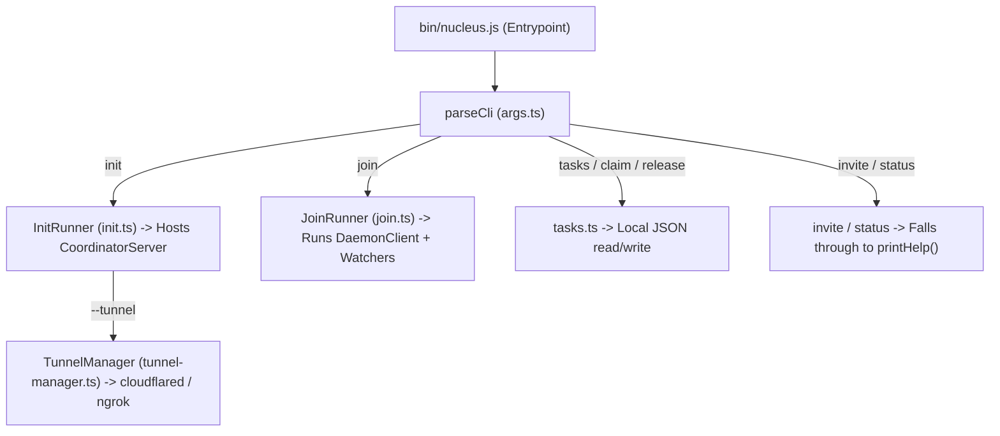

# `@nucleus/cli` — User Commands, Room Presets & Tunneling

> **Package Purpose:** The user-facing terminal tool (`nucleus`)—parses commands, hosts rooms (`init`), joins rooms (`join`), manages local task boards (`tasks`, `claim`, `release`), applies room presets (`engineering`, `dialectic`, `brainstorm`), and launches public internet tunnels.
> **Location:** `packages/cli/`

---

## CLI Command Routing & Runtime Architecture

### Package Configuration (`packages/cli/package.json` & `tsconfig.json`)
- **What it is for:** Registers the global `nucleus` binary pointing to `bin/nucleus.js` and depends on all four core packages (`protocol`, `coordinator`, `daemon`, `critic`).
- **What doesn't work as intended:** `bin/nucleus.js` imports from `../dist/index.js`, so any edits in TypeScript packages require running `npm run build` before the `nucleus` CLI reflects them.

---

## File-by-File Breakdown

### 1. `packages/cli/src/index.ts`
- **What it is for:** Re-exports all CLI runners, task helpers, presets, and tunnel utilities.
- **What it does & how:** Exports from `args`, `commands/init`, `commands/join`, `commands/tasks`, `presets/index`, and `tunnel/tunnel-manager`.
- **Why it exists:** Allows both `bin/nucleus.js` and integration tests (`cli.test.ts`, `system-audit.test.ts`) to drive CLI components programmatically.
- **What doesn't work as intended:** Works as intended.

---

### 2. `packages/cli/src/args.ts`
- **What it is for:** Parses CLI subcommands, positional arguments, and flags (`parseCli`) and prints usage text (`printHelp`).
- **What it does & how:** Uses Node's built-in `parseArgs` to recognize commands (`init`, `join`, `invite`, `status`, `tasks`, `claim`, `release`, `unclaim`, `help`) and flags (`--port`, `--room`, `--url`, `--token`, `--lane`, `--name`, `--workspace`, `--tunnel`, `--clean`, `--archived`, `--preset`, `--topic`, `--help`).
- **Why it exists:** Zero-dependency CLI parsing and user guidance.
- **What doesn't work as intended / Gaps:**
  - **Advertises unimplemented commands:** `parseCli` and `printHelp()` list `invite` and `status`, even though `bin/nucleus.js` doesn't handle either command.
  - **Swallows invalid flag errors:** Any unknown option causes `parseArgs` to throw and `parseCli` silently returns `command: "unknown", help: true` without telling the user which flag was misspelled.
  - **Missing `--check` / critic flags:** No options exist to pass deterministic check commands or pick an AI critic provider.

---

### 3. `packages/cli/bin/nucleus.js`
- **What it is for:** The executable Node script invoked when someone runs `nucleus ...` in a terminal.
- **What it does & how:**
  - Routes `tasks` (`--clean`, `--archived`, `--lane`), `claim`, `release`/`unclaim`, `init`, `join`, and `help`.
  - On `init`: starts `InitRunner`, prints LAN IP and `localhost` invite tokens, optionally starts `--tunnel` asynchronously, and handles `Ctrl+C` (`SIGINT`).
  - On `join`: validates `--url`, `--token`, `--lane`, connects `JoinRunner`, and keeps the process alive until `Ctrl+C`.
- **Why it exists:** Ties parsed CLI flags to the underlying runners.
- **What doesn't work as intended / Gaps:**
  - **`invite` and `status` do nothing:** Both fall straight into the `else` branch and print help text.
  - **Async `--tunnel` UX mismatch:** Prints `Press Ctrl+C to close room.` before the tunnel finishes starting, and formats tunnel invite commands using raw `preset.defaultLanes` rather than `preset.sampleInviteGuidance`. Also swallows tunnel failures silently without exiting or retrying.
  - **Single-token per preset lane:** `init` prints one single-use invite token per lane at startup. Because `nucleus invite` isn't implemented, there is no way for the host to generate a fresh token later if a teammate disconnects after 15 minutes or a second person wants to join the same lane!

---

### 4. `packages/cli/src/commands/init.ts`
- **What it is for:** Hosts a Nucleus room (`InitRunner`) on the Initiator's laptop.
- **What it does & how:**
  - Scaffolds `.nucleus/`, `.nucleus/logs/`, and `CONTRACT/`.
  - Loads the chosen preset (`engineering` by default) and writes initial `CONTRACT/` files, optional `CONTRACT/peers.template.md`, and `.nucleus/tasks.json` (only if those files don't already exist).
  - Starts `CoordinatorServer`, detects the machine's non-internal IPv4 LAN address (`getLocalIp`), builds invite command strings, and manages optional `TunnelManager`.
- **Why it exists:** One-command room setup for the host.
- **What doesn't work as intended / Gaps:**
  - **Does NOT wire Critique Gate checks:** Constructs `CoordinatorServer` *without* `repoRoot`, `worktreesDir`, or `deterministicChecks`—so Stage 1a Git worktree tests never run during real CLI sessions.
  - **Host is not auto-joined as a daemon:** Contrary to architecture diagrams showing the Initiator running a daemon inside `init`, `InitRunner` only runs the coordinator server—the host must open a second terminal and run `nucleus join` to sync local edits or receive `PEERS.md`/shadows.
  - **Topic placeholder inconsistency:** Replaces `"(Topic under investigation)"` inside contracts (present only in `dialectic.ts`), while `brainstorm.ts` only uses `topic` inside initial task titles and `engineering.ts` ignores `topic` entirely.
  - **LAN IP guessing:** `getLocalIp()` simply returns the first non-internal IPv4 interface it encounters, which on Windows with WSL, Docker, or VPN adapters often picks a virtual adapter IP instead of Wi-Fi.

---

### 5. `packages/cli/src/commands/join.ts`
- **What it is for:** Connects a contributor's local workspace (`JoinRunner`) to a hosted room and coordinates all local daemon modules.
- **What it does & how:**
  - Initializes `PeersIndexManager`, `ShadowMirror`, `ContractReplica`, `TaskBoardReplica`, and `DaemonClient`.
  - Applies incoming `session:room_snapshot` (populating `.nucleus/PEERS.md`, `.nucleus/tasks.json`, and `CONTRACT/`).
  - Handles real-time room messages (`session:peer_joined`, `session:severed`, `contract:update`, `sharing:file_focus_change`, `sharing:lane_shadow_sync`, `sharing:lane_shadow_delete`, `task:status`, `task:claim_failed`).
  - Starts `WorkspaceDiffWatcher`, writes `.nucleus/session.json`, and watches `.nucleus/tasks.json` for local claims, releases, or status edits (by humans or AI agents) to forward over WebSocket.
  - On `Ctrl+C`, removes `.nucleus/session.json`, stops watchers, and calls `client.sever()`.
- **Why it exists:** Turns a contributor's folder into a live Pure-Pull room node.
- **What doesn't work as intended / Gaps (Several Real Bugs):**
  1. **Peer focus bug:** On `sharing:file_focus_change`, calls `peersManager.updatePeerFocus(payload.lane, ...)` instead of looking up the peer by `nodeId`. Because `PeersIndexManager` stores peers by `nodeId`, `.nucleus/PEERS.md` never shows which file a teammate is actively editing unless `nodeId === lane`.
  2. **Never starts `ContractWatcher`:** `ContractReplica` receives updates from the coordinator, but `JoinRunner` never watches local `CONTRACT/` edits to lock and publish updates back to the room.
  3. **False critique instructions:** When a task gets `changes_requested`, logs *"Inspect `.nucleus/critiques/<id>.md`"*, even though the coordinator never sends critique files to remote contributors.
  4. **Shadow version mismatch & same-ms collisions:** Passes `Date.now()` as shadow `version` to `syncLaneShadow`/`deleteLaneShadow`, which collides if two files/edits flush in the same millisecond and causes `CoordinatorServer`'s hardcoded `version: 1` catch-up messages to be dropped on reconnect.
  5. **Task watcher bypasses optimistic concurrency & ignores task additions/archival:** Watches `.nucleus/tasks.json` and calls `claimTask` / `updateTaskStatus` without sending `expected_revision`; also ignores new tasks added locally or tasks archived locally.
  6. **Silent offline gaps on reconnect:** `onReconnect` calls `scanInitialWorkspace()`, which refreshes shadows for existing files—but edits made offline won't send live diff hunks, and files deleted while offline won't send `lane_shadow_delete`.

---

### 6. `packages/cli/src/commands/tasks.ts`
- **What it is for:** Implements local terminal operations on `.nucleus/tasks.json` (`listTasks`, `archiveCompletedTasksLocally`, `claimTaskLocally`, `releaseTaskLocally`).
- **What it does & how:**
  - `listTasks`: Formats active or archived tasks into a terminal table filtered by lane/status and prints `spec_file` / `spec_url` metadata.
  - `claimTaskLocally`: Reads `.nucleus/session.json` for default lane, validates lane match, non-blocked status, and unassigned/owner match, then sets `assigned_to` and `status: "active"`.
  - `releaseTaskLocally`: Resets task back to `unassigned`.
  - `archiveCompletedTasksLocally`: Moves `approved` tasks from `tasks.json` into `tasks_archive.json`.
- **Why it exists:** Lets developers and scripts inspect or update tasks quickly from the shell without editing JSON by hand.
- **What doesn't work as intended / Gaps:**
  - **Non-atomic writes:** Writes `.nucleus/tasks.json` and `tasks_archive.json` directly with `writeFileSync` instead of atomic temp+rename, risking partial reads by `JoinRunner`'s file watcher.
  - **Duplicate archives:** `archiveCompletedTasksLocally` blindly appends to `tasks_archive.json` without checking for duplicate task IDs (unlike `TaskBoardManager`), and does not inform the coordinator.
  - **Identity & state mismatch:** `claimTaskLocally` checks `task.assigned_to !== assignedTo` using a display name instead of `assigned_node_id`, never updates `revision` or `assigned_node_id`, and allows claiming `in_review` or `approved` tasks if `assigned_to` happens to match your name!

---

### 7. `packages/cli/src/tunnel/tunnel-manager.ts`
- **What it is for:** Starts a zero-config public TLS WebSocket tunnel (`TunnelManager`) using `cloudflared` or `ngrok`.
- **What it does & how:**
  - Returns `customUrl` immediately if supplied.
  - Spawns `cloudflared tunnel --url http://localhost:<port>`, watches stdout/stderr for a `trycloudflare.com` HTTPS URL (15s timeout), and converts it to `wss://`.
  - Falls back to spawning `ngrok http <port>` and polling `http://127.0.0.1:4040/api/tunnels` every 500ms (4s timeout).
- **Why it exists:** Allows remote teammates on different networks to join without router port forwarding.
- **What doesn't work as intended / Gaps:**
  - **Dead fallback path bug in `resolveCloudflaredBinary()`:** The loop checks `if (cand === "cloudflared") return cand;` on the first element (`"cloudflared"`), so it returns immediately and **never checks** the Windows `Program Files` or `WinGet` fallback paths right below it.
  - **Short ngrok timeout:** 4 seconds (`4000ms`) is often too brief for `ngrok` cold startup.
  - **No automatic process exit cleanup:** If `cloudflared` dies unexpectedly mid-session, `TunnelManager` doesn't alert the host or restart it.

---

### 8. `packages/cli/src/presets/` (`types.ts`, `index.ts`, `engineering.ts`, `dialectic.ts`, `brainstorm.ts`)
- **What they are for:** Define pluggable room templates (`--preset`) that scaffold initial `CONTRACT/` files, starter tasks, invite text, and optional `CONTRACT/peers.template.md` agent guidelines.
- **What each preset does:**
  - `index.ts` & `types.ts`: Define `RoomPreset` shape and look up `engineering`, `dialectic` (alias `debate`), or `brainstorm` (alias `strategy`), silently defaulting unknown names to `engineering`.
  - `engineering.ts`: Sets up `frontend`, `backend`, `qa` lanes, blank `CONTRACT/api.md`, and 2 starter tasks (`task-backend-01`, `task-frontend-01`).
  - `dialectic.ts`: Sets up `pro`, `contra`, `judge` lanes, `CONTRACT/topic.md`, `CONTRACT/axioms.md`, `CONTRACT/speaking_floor.md`, strict prose/180-word `peers.template.md` rules, and `round-01-pro` (`unassigned`) + `round-01-contra` (`blocked` on `round-01-pro`).
  - `brainstorm.ts`: Sets up `vision`, `skeptic`, `market`, `systems` lanes, `CONTRACT/PRD.md`, `CONTRACT/decisions.md`, and 4 parallel initial tasks.
- **Why they exist:** Reuse Nucleus's core synchronization loop across software development, adversarial debates, and product strategy.
- **What doesn't work as intended / Gaps:**
  - **`dialectic` `judge` lane inconsistency:** `defaultLanes` and `sampleInviteGuidance` advertise `judge`, yet no `judge` task is created; meanwhile `TaskBoardManager` keeps spawning rounds forever until a `judge` task is added and marked `approved` (or round 50).
  - **`brainstorm` coherence gate unimplemented:** `docs/generalized-consensus-and-room-presets.md` describes a Coherence Gate checking drafts against `CONTRACT/decisions.md`, which isn't implemented in `critic` without an LLM API key.
  - **Silent preset fallback:** Typoing `--preset dialetic` silently initializes `engineering` instead of warning the user.
