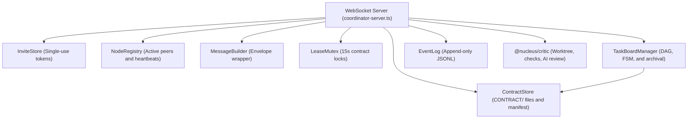
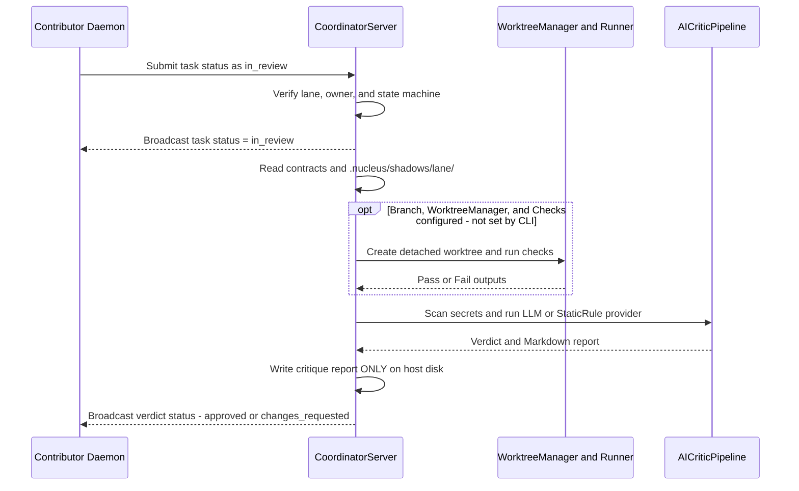

# `@nucleus/coordinator` — Room Server, Locks, Tasks & State

> **Package Purpose:** Runs the central room brain on the Host/Initiator's machine—authenticates peers, manages contract lease locks, routes live diffs and shadow files, enforces the task state machine, logs events, and triggers the Critique Gate.
> **Location:** `packages/coordinator/`

---

## Internal Component Diagram

### Package Configuration (`packages/coordinator/package.json` & `tsconfig.json`)
- **What it is for:** Declares `@nucleus/coordinator` depending on `@nucleus/protocol`, `@nucleus/critic`, `ws`, and `zod`.
- **What doesn't work as intended:** Notice `ContractStore` (`src/state/contract-store.ts`) is **not** re-exported by `src/index.ts`, even though callers sometimes access it via `server.getContractStore()`.

---

## File-by-File Breakdown

### 1. `packages/coordinator/src/index.ts`
- **What it is for:** Public barrel file exporting coordinator classes.
- **What it does & how:** Exports `LeaseMutex`, `EventLog`, `NodeRegistry`, `InviteStore`, `buildMessage`, `CoordinatorServer`, and `TaskBoardManager`.
- **Why it exists:** Gives `@nucleus/cli` and test suites clean imports.
- **What doesn't work as intended:** Omits `ContractStore` (and `ContractEntry`) from top-level exports.

---

### 2. `packages/coordinator/src/server/message-builder.ts`
- **What it is for:** Helper function `buildMessage` that wraps outgoing payloads into standard `@nucleus/protocol` envelopes.
- **What it does & how:** Attaches `room_id`, `node_id`, current timestamp `ts`, `type`, and `payload`. If an optional `secretKey` is provided, it signs the envelope via `signEnvelope`; otherwise it sets `sig` to `""`.
- **Why it exists:** Centralizes envelope construction and optional HMAC signing.
- **What doesn't work as intended:** `CoordinatorServer` never passes a `secretKey`, so every outbound envelope leaves with an empty signature string.

---

### 3. `packages/coordinator/src/lock/mutex.ts`
- **What it is for:** Implements `LeaseMutex`, a time-limited mutual exclusion lock table for shared `CONTRACT/` files.
- **What it does & how:**
  - `acquire(filePath, holderId, ttlSeconds=15)` grants a lock if no active lock exists or if the same `holderId` is renewing it; otherwise denies it.
  - `release(filePath, holderId)` unlocks only if the caller owns the lock.
  - `getLock(filePath)` checks if a lock exists and lazily purges expired leases.
  - `isExpiringSoon()` and `getExpiringLocks()` identify locks about to expire within a threshold window.
- **Why it exists:** Prevents two developers/agents from editing a shared contract file simultaneously, while automatically healing deadlocks after 15 seconds if a laptop crashes.
- **What doesn't work as intended / Gaps:**
  - **Proactive warnings are dead code:** `isExpiringSoon` and `getExpiringLocks` are never called anywhere in `CoordinatorServer`, so lock holders never receive expiration warnings.
  - **No lock-wait notifications:** Denied requesters must poll manually; there is no notification when a lock is released or expires.

---

### 4. `packages/coordinator/src/state/invite-store.ts`
- **What it is for:** Generates and validates single-use, lane-scoped join tokens (`InviteStore`).
- **What it does & how:**
  - `issue(lane)` creates a random 48-character hex token bound to a specific `lane` with a 15-minute default TTL.
  - `consume(token, nodeId)` marks the token as used and binds it to `nodeId`. If `used` is already true, it still lets the *exact same* `nodeId` reconnect using that token (while blocking any other `nodeId`).
  - `revoke(token)` deletes a token.
- **Why it exists:** Stops unauthorized users from joining or switching lanes, while letting legitimate laptops auto-reconnect after Wi-Fi drops without needing a new token.
- **What doesn't work as intended / Gaps:**
  - **In-memory only:** Tokens are never saved to disk. If the coordinator restarts, every active token vanishes and reconnecting contributors fail with `4003 Invalid or expired join token`.
  - **15-minute TTL on reconnect:** If a long coding session disconnects after 16 minutes (and the token was bound earlier), `consume()` checks `Date.now() > invite.expires_at` *before* checking `invite.bound_node_id === nodeId`—so a long-running peer gets locked out on reconnect!
  - **Stale token accumulation:** Expired tokens are only cleaned up if someone tries to consume that specific token. `revoke()` is also never exposed to any CLI command.

---

### 5. `packages/coordinator/src/state/node-registry.ts`
- **What it is for:** Tracks every currently connected peer (`NodeRegistry`) and detects timed-out nodes.
- **What it does & how:** Stores `node_id`, `lane`, `status` (`idle`, `active`, `review`), `task_id`, `contract_version`, `active_file`, and `last_heartbeat_at`. `evictStale(timeoutMs=20_000)` deletes nodes whose last heartbeat is older than 20 seconds.
- **Why it exists:** Keeps the room roster current and detects silently dropped laptops.
- **What doesn't work as intended / Gaps:**
  - Purely in-memory; does not track `display_name` (friendly contributor name) or persist disconnect history.

---

### 6. `packages/coordinator/src/state/event-log.ts`
- **What it is for:** Writes an append-only audit trail (`<roomId>.jsonl`) of key room events and provides a `replay()` reader.
- **What it does & how:** Appends one JSON line per event (`node_joined`, `node_severed`, `task_claimed`, `task_status_changed`, `contract_lock_acquired`, `contract_lock_released`, `contract_updated`, `critique_filed`, `task_approved`) and reads them back via `replay()`.
- **Why it exists:** Intended to provide immutable event-sourcing and crash recovery if the coordinator crashes.
- **What doesn't work as intended / Gaps:**
  - **`replay()` is never called in `CoordinatorServer`:** Crash recovery via log replay only exists in a benchmark test inspecting lines on disk—not in actual coordinator startup.
  - **Unused event types:** `critique_filed` and `task_approved` exist in the type definition, but `CoordinatorServer` logs `task_status_changed` instead.
  - **Fragile parsing:** `replay()` calls `JSON.parse` on every line without try/catch, so one corrupted line on crash breaks replay.

---

### 7. `packages/coordinator/src/state/contract-store.ts`
- **What it is for:** Authoritative disk store and version manager for `CONTRACT/` files on the coordinator machine.
- **What it does & how:**
  - Validates all paths against directory traversal and symlink escapes (`resolveSafePath` using lexical checks + `realpathSync`).
  - Persists files atomically (writes temp file, renames into place) alongside `.contracts-manifest.json` so version numbers survive coordinator restarts.
- **Why it exists:** Ensures contracts cannot be overwritten outside `CONTRACT/` and version numbers stay monotonic across restarts.
- **What doesn't work as intended / Gaps:**
  - **Flat directory scan on startup:** `loadFromDisk()` only reads direct files in `CONTRACT/` and skips folders. Subdirectory contracts (like `CONTRACT/specs/feature.md`) are **never loaded** when the coordinator starts, even though `update()` supports writing nested paths.
  - **Silent manifest write failures:** Errors inside `saveManifest()` are caught and ignored silently.

---

### 8. `packages/coordinator/src/task/task-board.ts`
- **What it is for:** Manages the shared task board (`.nucleus/tasks.json`), optimistic concurrency, state transitions, dependency DAG validation, archival, and dynamic dialectic round spawning.
- **What it does & how:**
  - **State Machine:** Enforces `LEGAL_TASK_TRANSITIONS` (e.g., `approved` is terminal; `unassigned` cannot jump straight to `approved`) unless `force = true` (initiator/judge).
  - **Optimistic Concurrency:** Increments `revision` on every claim or update and rejects stale `expected_revision` values.
  - **Identity Separation:** Stores `assigned_node_id` separately from `assigned_name` and `assigned_to` (`"DisplayName (nodeId)"`) so someone with the same display name cannot hijack another node's task.
  - **DAG & Contract Dependencies:** Rejects self-dependencies, missing task references, and cycles; automatically moves `blocked` tasks to `unassigned` once prerequisite tasks reach `approved` or required contract versions (`CONTRACT/file@2`) exist.
  - **Crash-Safe Archival:** Writes approved tasks into `.nucleus/tasks_archive.json` first before removing them from active `.nucleus/tasks.json`, and cleans up duplicates on restart if a crash interrupted the middle of archival.
  - **Dynamic Dialectic Spawning:** When a task named `round-<N>-contra` is approved, automatically creates `round-(N+1)-pro` (`unassigned`) and `round-(N+1)-contra` (`blocked`) up to round 50 unless a `judge` task is `approved`.
- **What doesn't work as intended / Gaps:**
  - **Domain coupling:** Dialectic debate round spawning (`round-XX-contra`) is hardcoded into the generic task board manager instead of living in presets/plugins.
  - **Heuristic `isContractRef`:** Assumes any dependency ending in `.md`, `.json`, `.yaml`, `.yml`, or `.txt` is a contract file rather than a task ID.
  - **`process.cwd()` fallback bug:** When `contractStore` isn't passed to `TaskBoardManager`, `isContractSatisfied` resolves `"CONTRACT"` relative to the current working directory instead of the workspace root.
  - **Circular dependency risk on startup:** `loadFromDisk()` warns on cycles rather than failing, and `archiveCompletedTasks()` can delete a parent task that a later task depends on (`depends_on_contracts` wouldn't see archived task IDs if evaluated later).

---

### 9. `packages/coordinator/src/server/coordinator-server.ts`
- **What it is for:** The central WebSocket server orchestrating connections, heartbeats, rate limits, file shadow syncing, contract locks, tasks, and the Critique Gate.
- **What it does & how:**
  - **Handshake & Quotas:** Requires `session:hello` as first message; checks token validity, lane match, and `maxClients` (default 32); kicks superseded duplicate `node_id` connections; sends `session:room_snapshot` plus existing shadows from other lanes; broadcasts `session:peer_joined`.
  - **Authoritative Reconstruction & Rate Limits:** Enforces `maxPayloadBytes` (5 MB), `maxFileSizeBytes` (2 MB), and 300 msgs/sec sliding window per node; drops unknown message types; overwrites sender `node_id`, `room_id`, and `lane` with authenticated server state before broadcasting.
  - **Shadow Storage & Containment:** Saves incoming peer files into `.nucleus/shadows/<lane>/` on the coordinator after checking lexical path containment, and fans them out to peers.
  - **Task & Critique Gate Pipeline:** Validates permissions (no self-approval, lane match, node ownership), updates `TaskBoardManager`, and when a task hits `in_review`, runs `runAutomatedCritique()`:
    1. Gathers all contracts + walks `.nucleus/shadows/<lane>/` as diff context.
    2. If `task.branch`, `worktreeManager`, and `deterministicChecks` are configured, creates a detached Git worktree and runs commands synchronously.
    3. Runs `SecretScanner` over the gathered shadow code.
    4. Invokes `AICriticPipeline` (`AutoLLMCriticProvider`).
    5. Writes `.nucleus/critiques/<task.id>.md` on the host and moves task status to `approved` or `changes_requested`.

- **What doesn't work as intended / Gaps (Major):**
  1. **Critique Gate missing checks in CLI:** `InitRunner` never sets `repoRoot`, `worktreesDir`, or `deterministicChecks`, so Stage 1a worktree checks never run from the CLI.
  2. **Critique files never sent to contributors:** `.nucleus/critiques/<id>.md` is only written to host disk—never broadcast over WebSocket.
  3. **Catch-up shadow version bug:** Catch-up shadow messages sent on join hardcode `version: 1`, while live syncs from `JoinRunner` use `Date.now()` timestamps. Reconnecting nodes with persisted `shadows-manifest.json` reject catch-up files as stale.
  4. **Shadow-only diff context + detached async critique:** `runAutomatedCritique` loads *every* file in `.nucleus/shadows/<lane>/` (even unrelated files, or empty if no daemon synced shadows), ignores `task.description` and `task.spec_file`, and runs unawaited (`fire-and-forget`).
  5. **No disconnect/eviction cleanup:** `handleDisconnect` and `evictStaleNodes` never release held `LeaseMutex` locks early, never unassign claimed tasks, and `evictStaleNodes` does not broadcast `session:severed`.
  6. **Unimplemented protocol features:** No TLS, no signature signing/verification, no `EventLog.replay()`, no `PeerFileReadRequest` handler, and catch-all `catch {}` in `handleMessage` swallows errors silently.
  7. **Shadow containment check lacks symlink resolution:** Unlike `WorkspaceJail`, coordinator's inline shadow path check uses `path.resolve`/`startsWith` without `realpathSync`.
