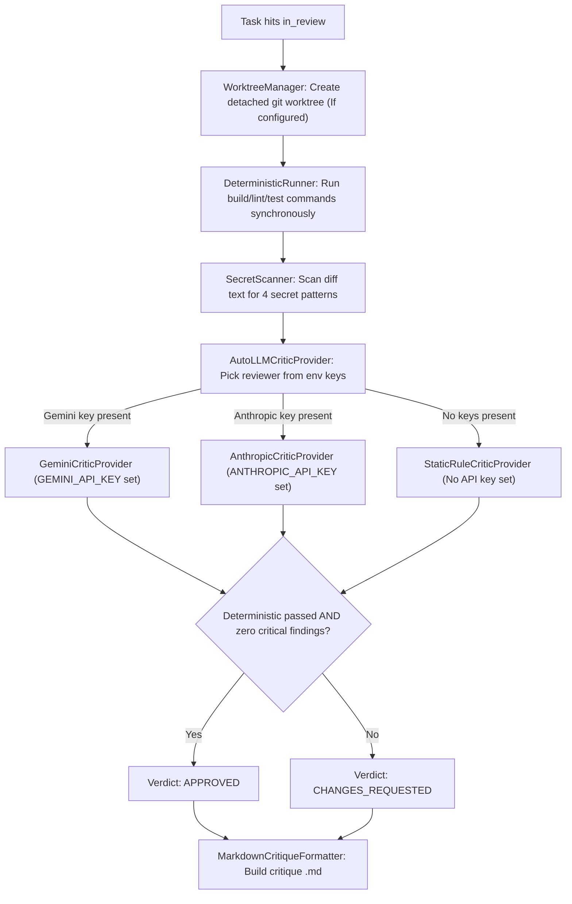

# `@nucleus/critic` — Two-Stage Verification & Review Engine

> **Package Purpose:** Evaluates tasks submitted for review by running deterministic checks inside disposable Git worktrees, scanning for leaked credentials, optionally calling an LLM reviewer (Gemini or Anthropic), and formatting `.nucleus/critiques/<task-id>.md`.
> **Location:** `packages/critic/`

---

## Critique Pipeline Flow

### Package Configuration (`packages/critic/package.json` & `tsconfig.json`)
- **What it is for:** Declares `@nucleus/critic` depending on `@nucleus/protocol` and `zod` (uses native Node `fetch` for LLM HTTP calls, no heavy SDKs).
- **What doesn't work as intended:** Notice `zod` is listed in `package.json`, though no file in `packages/critic/src/` uses `zod` directly.

---

## File-by-File Breakdown

### 1. `packages/critic/src/index.ts`
- **What it is for:** Public barrel file re-exporting all critic components.
- **What it does & how:** Exports `MarkdownCritiqueFormatter`, `AICriticPipeline`, `StaticRuleCriticProvider`, all LLM providers, `WorktreeManager`, `DeterministicRunner`, and `SecretScanner`.
- **Why it exists:** Gives `@nucleus/coordinator` and tests clean imports.
- **What doesn't work as intended:** Works as intended.

---

### 2. `packages/critic/src/worktree/worktree-manager.ts`
- **What it is for:** Creates and deletes temporary isolated Git checkouts (`WorktreeManager`) so test runners never touch the host's main working directory.
- **What it does & how:**
  - `createWorktree(taskId, branch)` cleans up any leftover worktree from a crash and runs `git worktree add --detach` for the target branch.
  - `removeWorktree(taskId)` runs `git worktree remove --force`, falling back to recursive folder removal plus `git worktree prune` if needed.
- **Why it exists:** Lets the Critique Gate test a contributor's branch safely without disturbing whatever code the Host developer is editing locally.
- **What doesn't work as intended / Gaps:**
  - **Not wired by CLI:** `InitRunner` (`nucleus init`) never creates a `WorktreeManager`, so worktrees are only used in tests or custom scripts.
  - **Committed branches only:** Can only check out branches already committed and reachable in the host's local Git repo; uncommitted shadow code cannot be tested inside a worktree.

---

### 3. `packages/critic/src/runner/deterministic-runner.ts`
- **What it is for:** Executes shell commands (builds, typechecks, unit tests, linters) inside a directory and captures pass/fail status, output, and timing (`DeterministicRunner`).
- **What it does & how:** Loops over each configured check command, runs it via `execSync` with a 30-second default timeout, caps captured output at 5,000 characters, and returns overall pass/fail plus per-check results.
- **Why it exists:** Stage 1 verification catches broken builds and failing tests deterministically at zero AI token cost.
- **What doesn't work as intended / Gaps:**
  - **Blocks the entire Coordinator event loop:** Because it uses synchronous `execSync`, running a 25-second test suite freezes the entire WebSocket coordinator—no heartbeats or diffs are processed, causing `NodeRegistry.evictStale(20_000)` to kick connected peers right after checks finish!
  - **Never invoked from CLI:** `InitRunner` doesn't expose any flag or config to specify check commands.

---

### 4. `packages/critic/src/scanner/secret-scanner.ts`
- **What it is for:** Deterministic regex scanner (`SecretScanner`) catching hardcoded credentials before code gets approved.
- **What it does & how:** Scans a string line-by-line (`scanFile`) or walks a directory (`scanDirectory`, skipping `node_modules`, `.git`, `dist`, `.nucleus`) against 4 patterns: Private Key headers, AWS Access Key IDs (`AKIA...`), Stripe live keys (`sk_live_...`), and generic `api_key`/`password`/`secret` assignments. Any hit emits a `critical` finding with line number and remediation advice.
- **Why it exists:** Prevents accidental credential leaks from passing review.
- **What doesn't work as intended / Gaps:**
  - **Same narrow pattern set:** Misses common modern secrets like GitHub PATs (`ghp_`, `github_pat_`), OpenAI (`sk-`), Anthropic (`sk-ant-`), Google API keys (`AIza`), Slack tokens, and database connection strings with embedded passwords.
  - **Scans whole shadow files as diff:** Because `CoordinatorServer` builds `diffContext` from all files in `.nucleus/shadows/<lane>/`, even placeholder values in existing test fixtures inside that lane trigger rejection.

---

### 5. `packages/critic/src/reviewer/ai-critic.ts`
- **What it is for:** Orchestrates the two-stage critique pipeline (`AICriticPipeline`) and provides the default rule-based reviewer (`StaticRuleCriticProvider`).
- **What it does & how:**
  - **`StaticRuleCriticProvider`:** Runs `SecretScanner`, emits a `warning` if the diff is empty, and—specifically when `lane` is `"pro"` or `"contra"`—enforces a **200-word maximum** (`critical` violation) and warns against robotic Markdown headings (`**Premise:**`, `**Conclusion:**`).
  - **`AICriticPipeline.evaluate()`:** Collects Stage 1 deterministic failure outputs, scans `diff` with `SecretScanner` (forcing `deterministicPassed = false` on secrets), invokes the configured `LLMCriticProvider`, marks the verdict `approved` only if deterministic checks passed and no finding has severity `"critical"`, and formats the report via `MarkdownCritiqueFormatter`.
- **Why it exists:** Separates hard deterministic rules from semantic LLM review while ensuring a clean zero-token default mode.
- **What doesn't work as intended / Gaps:**
  - **200-word dialectic rule disappears if you add an API key:** `StaticRuleCriticProvider` is only used as a fallback when no API key is present! Turning on Gemini or Anthropic completely skips the empty-diff warning and the `pro`/`contra` dialectic brevity guard.
  - **Duplicate secret scanning:** `CoordinatorServer` scans `diffContext` with `SecretScanner` (Stage 1b), `AICriticPipeline` scans `context.diff` again, and `StaticRuleCriticProvider` scans it a *third* time—producing duplicate critical findings in the critique report.
  - **LLM errors still approve tasks:** If `this.provider.review()` throws an error, `AICriticPipeline` catches it and adds a `"warning"` finding (not `"critical"`), so the overall verdict still comes back **`approved`**!
  - **Hardcoded debate logic:** Dialectic `pro`/`contra` rules shouldn't live inside the generic static provider.

---

### 6. `packages/critic/src/reviewer/providers/auto-provider.ts`
- **What it is for:** Automatically selects an LLM reviewer (`AutoLLMCriticProvider`) from environment variables.
- **What it does & how:** Checks `GEMINI_API_KEY` first, `ANTHROPIC_API_KEY` second, and otherwise falls back to `StaticRuleCriticProvider`.
- **Why it exists:** Zero-config convenience so `CoordinatorServer` adapts automatically if the host exports an API key.
- **What doesn't work as intended / Gaps:**
  - No option or CLI flag to choose provider order, override models, or combine `StaticRuleCriticProvider` rules with an LLM provider.

---

### 7. `packages/critic/src/reviewer/providers/gemini-provider.ts` & `anthropic-provider.ts` (& `index.ts`)
- **What they are for:** Call the Google Gemini REST API (`gemini-2.0-flash` default) or Anthropic Messages API (`claude-3-5-sonnet-20241022` default) to review code diffs against task specs and contracts.
- **What they do & how:**
  - Build a prompt containing task ID, lane, specification, deterministic check outputs, and diff text, requesting a strict JSON array of findings.
  - Parse the returned JSON array (stripping code fences if needed) into `CriticFindingItem[]`.
- **Why they exist:** Provides semantic architectural review—checking whether code actually satisfies `CONTRACT/` rather than just compiling.
- **What doesn't work as intended / Gaps:**
  - **Silent pass-through on API failure or bad JSON:** Missing keys return severity `"info"`, and HTTP errors (401, 403, 429, 500) or JSON parse failures return severity `"warning"`. Because `AICriticPipeline` only rejects on `"critical"`, **API outages, invalid keys, rate limits, and malformed model output all cause tasks to be `approved`!**
  - **No diff size limit or timeout:** Sending a large `.nucleus/shadows/<lane>/` directory dump can blow past prompt limits or hang `fetch` without an `AbortController` timeout.
  - **Aging default model IDs:** Hardcoded model names (`gemini-2.0-flash`, `claude-3-5-sonnet-20241022`) may become deprecated over time with no CLI override.

---

### 8. `packages/critic/src/reviewer/formatter.ts`
- **What it is for:** Formats a `CriticResult` into human- and AI-readable Markdown (`MarkdownCritiqueFormatter`).
- **What it does & how:** Renders task ID, lane, uppercase verdict, deterministic check status, and a bulleted section per finding (`severity`, `file:line`, `Issue`, `Suggested Fix`).
- **Why it exists:** Produces `.nucleus/critiques/<task-id>.md` so contributor AI agents can read exact feedback and fix issues iteratively.
- **What doesn't work as intended / Gaps:** Works cleanly on its own, though as noted in `@nucleus/coordinator`, the formatted file is never sent over WebSocket to remote contributors.
