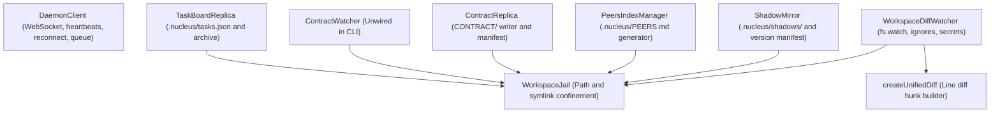
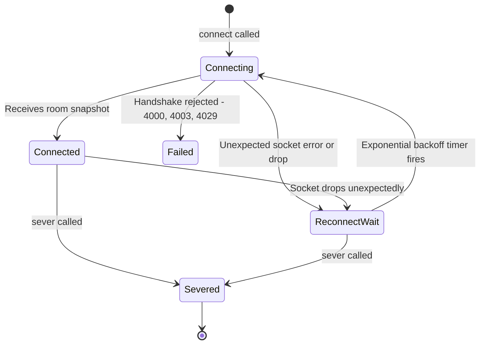

# `@nucleus/daemon` — Contributor Background Companion

> **Package Purpose:** Runs locally on each contributor's machine to keep the room connected, jail all disk reads/writes inside the project folder, watch source files for live diffs and shadows, replicate `CONTRACT/` and `.nucleus/tasks.json`, and generate `.nucleus/PEERS.md` for local AI tools.
> **Location:** `packages/daemon/`

---

## Package Component Diagram

### Package Configuration (`packages/daemon/package.json` & `tsconfig.json`)
- **What it is for:** Configures `@nucleus/daemon` as an ESM package depending on `@nucleus/protocol`, `ws`, and `zod`.
- **What doesn't work as intended:** Notice `zod` is listed in dependencies even though none of the source files inside `packages/daemon/src/` import `zod` directly (validation uses `@nucleus/protocol`).

---

## File-by-File Breakdown

### 1. `packages/daemon/src/index.ts`
- **What it is for:** Public barrel export for `@nucleus/daemon`.
- **What it does & how:** Re-exports `WorkspaceJail`, `DaemonClient`, `ContractReplica`, `ContractWatcher`, `PeersIndexManager`, `ShadowMirror`, `createUnifiedDiff`, `WorkspaceDiffWatcher`, and `TaskBoardReplica`.
- **Why it exists:** Gives `@nucleus/cli` and tests clean package-level imports.
- **What doesn't work as intended:** Works as intended.

---

### 2. `packages/daemon/src/jail/jail.ts`
- **What it is for:** Security boundary (`WorkspaceJail`) ensuring remote messages or file watchers can never read or write outside the bound project directory.
- **What it does & how:**
  - Normalizes the workspace root and resolves its real filesystem path (`realpathSync`).
  - `resolveSafe(targetPath)` performs a two-layer containment check:
    1. **Lexical check:** Confirms the resolved path starts with the workspace root (case-insensitive on Windows) and doesn't begin with `..`. Also stops prefix-sharing tricks like `../project_secret/`.
    2. **Symlink / Windows junction check:** Calls `realpathSync` on existing files—or walks up to the nearest existing parent folder for files not created yet—to reject symlinks pointing outside the project.
- **Why it exists:** Prevents a compromised peer or crafted path from tricking a contributor's daemon into overwriting `~/.ssh/id_rsa`, `.env`, or system files.
- **What doesn't work as intended / Gaps:**
  - **Silent catch on unexpected filesystem errors:** Inside the `try/catch` around `realpathSync`, any error whose message doesn't start with `"Security Exception:"` (such as permission errors or weird special paths) is silently ignored, allowing the method to return the lexically resolved path anyway.

---

### 3. `packages/daemon/src/client/daemon-client.ts`
- **What it is for:** Manages the persistent WebSocket connection (`DaemonClient`) from a contributor's machine to the coordinator.
- **What it does & how:**
  - **Handshake:** Opens WebSocket, immediately sends `session:hello`, and waits for `session:room_snapshot` before resolving `connect()`.
  - **Heartbeats:** Sends `session:heartbeat` every 2 seconds (default) with status, active file, task ID, and contract version.
  - **Auto-Reconnect:** On unexpected closes (except code `1000` normal exit or `4003` bad/mismatched token), waits with exponential backoff (`1s, 2s, 4s, 8s, 16s`, capped at `30s`, plus small random jitter) and retries automatically.
  - **Offline Queue:** While disconnected, buffers up to 100 critical messages (`task:*`, `contract:*`, `sharing:lane_shadow_*`, `sharing:file_focus_change`), dropping the oldest if full, and flushes them right after receiving `session:room_snapshot` upon reconnect.
  - **Clean Sever:** `sever()` cancels timers, empties the queue, and closes with `1000 user_exit`.

- **What doesn't work as intended / Gaps:**
  - **`contractVersion` never updates:** Every heartbeat sends `contract_version: 0` because nothing ever updates `this.contractVersion`.
  - **Hardcoded `room_id: "room"` and `cli: "unknown"`:** Outbound packets always send `"room"` instead of the actual snapshot `room_id` (relying on the coordinator to rewrite it), and capabilities never detect the user's AI tool.
  - **Live diffs dropped offline:** `isQueueableMessage` excludes `sharing:live_diff_stream`, so diffs edited offline are never sent on reconnect.
  - **Stale queued task updates:** Flushed offline task claims/updates are replayed blindly without updating `expected_revision` against the fresh snapshot just received.
  - **No cryptographic signing:** Never signs or verifies envelope `sig` values.

---

### 4. `packages/daemon/src/watcher/diff-generator.ts`
- **What it is for:** Pure helper (`createUnifiedDiff`) that turns old and new file contents into a Git-style unified diff hunk.
- **What it does & how:**
  - Returns empty string if unchanged.
  - Formats full additions for new files (`--- /dev/null`) and full deletions for removed files (`+++ /dev/null`).
  - For modified files, scans matching lines from the top (`prefix`) and bottom (`suffix`), then emits a single hunk with 3 context lines around everything in between.
- **Why it exists:** Keeps live diff packets readable and familiar to developers and LLMs without shelling out to `git diff` on every keystroke.
- **What doesn't work as intended / Gaps:**
  - **Single-hunk limitation:** Because it only strips a common prefix and common suffix, editing line 1 and line 500 of a 500-line file causes the **entire 500-line middle block** to be sent as removed and re-added rather than two separate hunks.

---

### 5. `packages/daemon/src/watcher/diff-watcher.ts`
- **What it is for:** Watches the local workspace (`WorkspaceDiffWatcher`), filters noise and secrets, computes line diffs, and emits live diff and shadow sync callbacks.
- **What it does & how:**
  - **Hardened Ignore Rules:** Always blocks `GLOBAL_NON_BYPASSABLE_IGNORES` (`node_modules`, `.git`, `dist`, `build`, `.next`, `.nucleus/shadows`, `.cache`, `.turbo`, `coverage`, `out`), sensitive filenames (`.env*`, `.npmrc`, `.pypirc`, `id_rsa`, `credentials*.json`, `service-account*.json`, `.pem`/`.key`/`.crt` files), binary extensions, files over 2 MB, and buffers containing null bytes (`0x00`) in the first 1 KB.
  - **Initial Scan:** On `start()`, walks the workspace to snapshot existing files and push initial shadow copies to peers without spamming `live_diff_stream`.
  - **Debounced Watching:** Uses recursive `fs.watch` with a 300ms default debounce. On save, computes a unified diff (truncating only `diff_hunk` at 50 KB while still sending full shadow content via `onShadowSync`), or triggers `onShadowDelete` if the file disappeared.
  - **Pre-Broadcast Secret Guardrail:** Checks file text against 4 secret regexes (`PRIVATE KEY`, AWS `AKIA...`, Stripe `sk_live_...`, generic `password`/`api_key` assignments). If found, suppresses the diff hunk and skips shadow sync.
- **Why it exists:** Gives teammates sub-second visibility into edits while protecting secrets, dependencies, and binary files from flooding the network.
- **What doesn't work as intended / Gaps:**
  - **`.nucleus` folder is only *default*-ignored, not non-bypassable:** `GLOBAL_NON_BYPASSABLE_IGNORES` blocks `.nucleus/shadows` but omits `.nucleus` itself (`tasks.json`, `PEERS.md`, `logs/`, `session.json`). Passing custom `ignoredPatterns` without `".nucleus"` leaks internal state files as code diffs.
  - **Noisy focus events & missing `"idle"` signal:** Fires `onFocusChange(file, "editing")` on *every* raw OS `fs.watch` event before debouncing, and never transitions focus back to `"idle"` after editing pauses (only on deletion).
  - **Substring match overreach:** When an ignore rule contains `/`, `isIgnored` checks `normalized.includes(pattern)`, which can accidentally ignore unrelated folders matching that substring.
  - **Narrow secret detection:** Only catches 4 legacy regex patterns; modern secrets like GitHub tokens (`ghp_`), OpenAI (`sk-`), Anthropic (`sk-ant-`), Google (`AIza`), or JWTs pass right through.
  - **Stale shadow on secret leak:** If a file was synced clean earlier and someone later pastes a secret into it, shadow sync is skipped—meaning peers keep the old shadow copy instead of redacting or removing it.

---

### 6. `packages/daemon/src/shadow/shadow-mirror.ts`
- **What it is for:** Receives peer shadow syncs and deletes (`ShadowMirror`) and maintains local mirror files under `.nucleus/shadows/<lane>/`.
- **What it does & how:**
  - Tracks file versions (`source_lane:file_path`) in memory and persists them atomically to `.nucleus/shadows-manifest.json`.
  - Ignores incoming updates or deletions whose `version` is less than or equal to the already-applied version.
  - Deletes files cleanly on `deleteShadowFile` and prunes empty nested folders up to the lane folder.
  - Enforces `WorkspaceJail` on every read, write, and delete.
- **Why it exists:** Lets a developer's local AI inspect teammates' live uncommitted code directly on disk.
- **What doesn't work as intended / Gaps:**
  - **Version collision with coordinator catch-up:** When `JoinRunner` streams shadows, it sends `Date.now()` as `version` (huge millisecond timestamp), whereas `CoordinatorServer` catch-up on reconnect hardcodes `version: 1`. Any peer that already saved `shadows-manifest.json` rejects catch-up files as stale (`1 <= Date.now()`).
  - **Same-millisecond drop risk:** Using `Date.now()` in `JoinRunner` means two syncs for the same file within the same millisecond get the exact same version, so the second one is dropped as a duplicate (`<= currentVersion`).
  - **Non-atomic file writes:** `saveManifest()` uses temp-file + rename, but `applySync()` writes the shadow source file directly with `writeFileSync`.
  - **No multi-user same-lane isolation:** Two teammates both on `--lane backend` overwrite each other inside `.nucleus/shadows/backend/`.

---

### 7. `packages/daemon/src/shadow/peers-index.ts`
- **What it is for:** Writes and updates `.nucleus/PEERS.md` (`PeersIndexManager`) so local AI agents automatically discover teammates and read collaboration rules.
- **What it does & how:**
  - Keeps an in-memory map of peers keyed by `nodeId` (`lane`, `status`, `activeFile`).
  - Renders a Markdown table mapping each peer to `.nucleus/shadows/<lane>/`, plus built-in agent instructions for reading `spec_file`, `spec_url`, `description`, `CONTRACT/api.md`, and shadow folders.
  - Appends custom project instructions if `CONTRACT/peers.template.md` or `.nucleus/peers.template.md` exists.
- **Why it exists:** Bridges WebSocket room awareness into plain Markdown that AI coding agents already know how to read.
- **What doesn't work as intended / Gaps:**
  - **Broken live focus update in CLI:** `JoinRunner` passes `payload.lane` (e.g., `"backend"`) into `updatePeerFocus(nodeId, ...)`, where keys are actually `nodeId` (e.g., `"Kshitiz"` or `"node-backend-abc"`), so `Active File / Focus` never updates in practice.
  - **Non-atomic writes & single-file display:** `render()` calls `writeFileSync` directly and only tracks one active file per peer.
  - **Missing human names:** Only displays `nodeId` and `lane`, not friendly names if `nodeId` is auto-generated.

---

### 8. `packages/daemon/src/contract/contract-replica.ts`
- **What it is for:** Safely writes incoming `CONTRACT/` updates from the coordinator onto the contributor's disk (`ContractReplica`).
- **What it does & how:**
  - Maintains `.nucleus/contracts-manifest.json` so contract versions persist across daemon restarts.
  - Drops stale or duplicate updates (`broadcast.version <= currentVer`) and writes newer updates inside `CONTRACT/` via `WorkspaceJail`.
- **Why it exists:** Ensures contributors never accidentally revert a newer contract with an older cached broadcast.
- **What doesn't work as intended / Gaps:**
  - Writes contract files directly (`writeFileSync`) instead of atomic temp-file + rename.

---

### 9. `packages/daemon/src/contract/contract-watcher.ts`
- **What it is for:** Watches `CONTRACT/` locally (`ContractWatcher`) and fires a callback when a developer or AI edits a contract file.
- **What it does & how:** Uses non-recursive `fs.watch` on `CONTRACT/` with a 300ms debounce, reads updated files safely through `WorkspaceJail`, and notifies `onContractChange`.
- **Why it exists:** Intended to automatically detect local contract edits so the daemon can lock, publish, and broadcast them.
- **What doesn't work as intended / Gaps:**
  - **Completely unwired in the CLI:** `JoinRunner` never creates or starts `ContractWatcher`! Local edits to `CONTRACT/` on a contributor laptop are never sent to the coordinator unless done via raw `DaemonClient` API calls in tests.
  - **Non-recursive watch:** Watches with `recursive: false`, missing nested files such as `CONTRACT/specs/*.md`.

---

### 10. `packages/daemon/src/task/task-replica.ts`
- **What it is for:** Maintains the contributor's local `.nucleus/tasks.json` and `.nucleus/tasks_archive.json` (`TaskBoardReplica`).
- **What it does & how:**
  - Applies full task snapshots from the coordinator (`applySnapshot`) and individual task status updates (`applyUpdate`), rejecting out-of-order updates where `task.revision < existing.revision`.
  - Uses atomic temp-file + rename writes and provides `archiveCompletedTasks()`.
- **Why it exists:** Keeps the local task board accurate for the user, CLI commands, and local AI agents.
- **What doesn't work as intended / Gaps:**
  - **Snapshot overwrites offline local edits:** When connecting or reconnecting, `applySnapshot` completely overwrites `.nucleus/tasks.json` with the coordinator's list, wiping any local uncommitted edits made while offline.
  - **Local-only archival:** `archiveCompletedTasks()` updates local JSON without notifying the coordinator.
