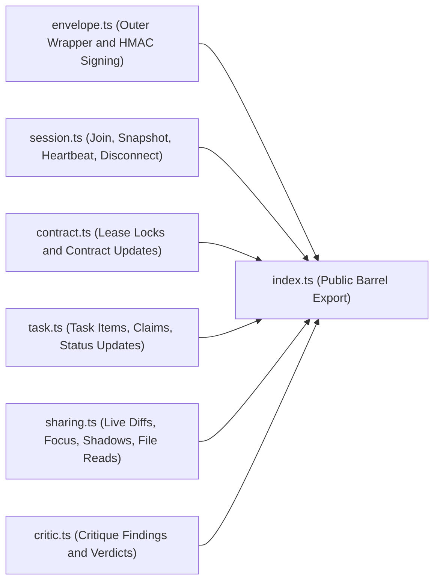

# `@nucleus/protocol` — Shared Wire Contracts & Signing Utilities

> **Package Purpose:** Defines every data shape sent between nodes and the coordinator, plus cryptographic envelope helpers. Has zero dependencies on any other Nucleus package (only uses `zod` and Node's built-in `crypto`).
> **Location:** `packages/protocol/`

---

## Package Architecture & Message Map

### Package Configuration (`packages/protocol/package.json` & `tsconfig.json`)
- **What it is for:** Declares `@nucleus/protocol` as an ESM package compiled into `dist/` and declares `zod` as its sole runtime dependency.
- **What doesn't work as intended:** Nothing broken here, though all sibling packages consume it via `dist/`, requiring `npm run build` after any schema edit for compiled runners (`nucleus` CLI) to pick up changes.

---

## File-by-File Breakdown

### 1. `packages/protocol/src/index.ts`
- **What it is for:** Single public entry point re-exporting every schema, type, and helper in the package.
- **What it does & how:** Re-exports everything from `envelope`, `session`, `contract`, `task`, `sharing`, and `critic`.
- **Why it exists:** Ensures `@nucleus/coordinator`, `@nucleus/daemon`, `@nucleus/critic`, and `@nucleus/cli` all import from `@nucleus/protocol` instead of deep internal paths.
- **What doesn't work as intended:** Works as intended.

---

### 2. `packages/protocol/src/envelope.ts`
- **What it is for:** Defines the standard outer wrapper ("envelope") around every WebSocket message and provides HMAC-SHA256 signing and verification functions.
- **What it does & how:**
  - Every network packet must carry six fields: `room_id`, `node_id`, integer timestamp `ts`, message `type`, generic `payload`, and `sig` (defaults to empty string).
  - `computeEnvelopeSignature` joins `room_id`, `node_id`, `ts`, `type`, and the JSON-serialized payload with colons and hashes them with a secret room key.
  - `signEnvelope` attaches that hex signature; `verifyEnvelopeSignature` compares signatures in constant time (`timingSafeEqual`) to prevent timing attacks.
- **Why it exists:** Gives the network layer a uniform frame format and a way to prove messages weren't tampered with in transit.
- **What doesn't work as intended / Gaps:**
  - **Unused in live transport:** Neither `CoordinatorServer` nor `DaemonClient` ever signs outgoing messages or verifies incoming signatures—every packet in production travels with an empty `sig`.
  - **Payload ordering fragility:** Because `computeEnvelopeSignature` uses standard `JSON.stringify(envelope.payload)` without sorting object keys, two different serializers producing equivalent JSON with keys in different order would fail verification if signing were turned on.
  - **Empty payload edge case:** If `payload` were `undefined`, `JSON.stringify` returns `undefined`, which silently serializes as the literal text `"undefined"` in the template string.

---

### 3. `packages/protocol/src/session.ts`
- **What it is for:** Defines messages for joining a room, receiving initial room state, staying alive via heartbeats, and disconnecting.
- **What it does & how:**
  - **Capabilities:** Records which AI CLI (`claude-code`, `antigravity`, `aider`, etc.), OS platform, and version a node runs.
  - **Hello (`session:hello`):** Sent first on connect with `node_id`, single-use `join_token`, local `workspace_path`, requested `lane`, and capabilities.
  - **Room Snapshot (`session:room_snapshot`):** Sent by coordinator right after accepting a joiner; includes room ID, peer roster (`node_id`, `lane`, `status`), contract version, task count, full `tasks` list, and full `contracts` array.
  - **Heartbeat (`session:heartbeat`):** Periodic ping containing node `status` (`idle`, `active`, `review`), active `task_id`, `contract_version`, and `active_file`.
  - **Severed (`session:severed`):** Disconnect notification carrying `node_id` and `reason` (`user_exit`, `timeout`, or `kicked`).
- **Why it exists:** Establishes trust at connection time and keeps every peer synchronized on initial state and liveness.
- **What doesn't work as intended / Gaps:**
  - **Missing display name in `peers`:** `RoomSnapshotPayloadSchema` only stores `node_id`, `lane`, and `status` for peers—there is no `display_name` or `active_file` field in the snapshot peer entries, so newly joined peers don't immediately know teammates' friendly names or currently edited files.
  - **Missing critiques in snapshot:** Newly joined or reconnecting contributors do not receive `.nucleus/critiques/` files in the room snapshot.
  - **Missing schemas for coordinator-sent errors and peer events:** Messages actually sent by `CoordinatorServer` like `session:peer_joined` have no Zod schema here. Also `"kicked"` is defined in `SeveredPayloadSchema`, though no kick mechanism exists in the coordinator.

---

### 4. `packages/protocol/src/contract.ts`
- **What it is for:** Defines messages for locking, releasing, requesting updates, and broadcasting updates to shared `CONTRACT/` files.
- **What it does & how:**
  - **Lock Request:** File path plus `ttl_seconds` (1 to 60 seconds, default 15).
  - **Lock Grant:** Confirms `file_path`, `holder_id`, and `lease_expires_at` timestamp.
  - **Lock Release:** Names the `file_path` to unlock.
  - **Contract Update Request & Broadcast:** Carries `file_path`, full text `content`, `touched_sections` tags, and (on broadcast) monotonically increasing positive `version`.
- **Why it exists:** Prevents two lanes from overwriting shared specs at the same time (pessimistic lease locking) while broadcasting changes immediately.
- **What doesn't work as intended / Gaps:**
  - **`contract:lock_denied` has no schema:** The coordinator sends `contract:lock_denied` with `held_by` and `expires_at`, yet that payload shape is not defined in `contract.ts` (breaking the rule in `CLAUDE.md` that every payload must live in `@nucleus/protocol`).
  - **Full-file transport only:** Every update sends the entire file `content` rather than incremental patches, and `touched_sections` is always empty in practice.

---

### 5. `packages/protocol/src/task.ts`
- **What it is for:** Defines the shared task board item, legal statuses, claim payload, and status-change payload.
- **What it does & how:**
  - **Allowed Statuses:** `unassigned`, `assigned`, `active`, `in_review`, `changes_requested`, `approved`, `blocked`.
  - **Task Item:** Tracks `id`, `title`, `lane`, `status`, optional optimistic-concurrency `revision`, `assigned_to`, `assigned_node_id`, `assigned_name`, `depends_on_contracts` (list of contract file refs or task IDs), `branch`, `description`, `spec_file`, and `spec_url`.
  - **Claim & Status Updates:** Allow passing `display_name` and optional `expected_revision` so stale edits can be rejected.
- **Why it exists:** Forms the single source of truth for task ownership, dependencies, and review workflow across coordinator, daemons, and CLI.
- **What doesn't work as intended / Gaps:**
  - **Legacy field name:** `depends_on_contracts` is overloaded to hold *both* contract file references (like `CONTRACT/api.md@2`) *and* prerequisite task IDs (like `round-01-pro`), which is confusing and forces heuristic file-extension guessing in `TaskBoardManager`.
  - **Missing error schemas:** `task:claim_failed` and `task:update_failed` messages emitted by the coordinator have no Zod schemas defined here.
  - **No task creation/deletion messages:** There is no protocol message for adding, editing, or archiving tasks from a client—tasks can only be added at initialization or directly via coordinator code.

---

### 6. `packages/protocol/src/sharing.ts`
- **What it is for:** Defines real-time code visibility messages—live diff streams, active file focus events, shadow file sync/deletions, and peer file read requests.
- **What it does & how:**
  - **Live Diff Stream:** Broadcasts `lane`, `active_file`, `files_changed`, human-readable `patch_summary`, and optional unified `diff_hunk`.
  - **File Focus Change:** Reports when a lane is `"editing"`, `"idle"`, or `"saved"` on a given file.
  - **Shadow Sync & Delete:** Replicates full file text or deletion events into peers' `.nucleus/shadows/<source_lane>/` folders with positive integer `version`.
  - **Peer File Read Request/Response:** Designed to let one node ask another lane for a file directly on demand.
- **Why it exists:** Enables instant cross-lane code awareness without Git commits or pushes.
- **What doesn't work as intended / Gaps:**
  - **Dead / Unimplemented Schemas:** `PeerFileReadRequestSchema` and `PeerFileReadResponseSchema` are completely unused anywhere in `coordinator`, `daemon`, or `cli`.
  - **No `node_id` on `FileFocusChangeSchema`:** Focus messages only specify `lane` (not `node_id`), creating ambiguity when multiple peers share a lane and causing a lookup bug in `JoinRunner` (`PeersIndexManager` indexes peers by `nodeId`).
  - **Version semantics:** `LaneShadowSyncSchema.version` only validates a positive integer, allowing `JoinRunner` to send `Date.now()` timestamps while `CoordinatorServer` catch-up sends `1`.

---

### 7. `packages/protocol/src/critic.ts`
- **What it is for:** Defines structured review findings and overall verdict objects produced by the Critique Gate.
- **What it does & how:**
  - **Finding Item:** Holds `severity` (`critical`, `warning`, `info`), `file`, optional `line`, `message`, and optional `suggested_fix`.
  - **Critic Result:** Holds `task_id`, `lane`, `verdict` (`approved` or `changes_requested`), boolean `deterministic_checks_passed`, `findings` array, and `critique_file_path`.
- **Why it exists:** Standardizes review results so the coordinator and markdown formatter speak one language.
- **What doesn't work as intended / Gaps:**
  - **Never sent over the wire:** Despite being in `@nucleus/protocol`, neither `CriticResult` nor `CriticFindingItem` is ever sent over WebSocket to contributors—the coordinator only writes `.md` locally and broadcasts `task:status`.
