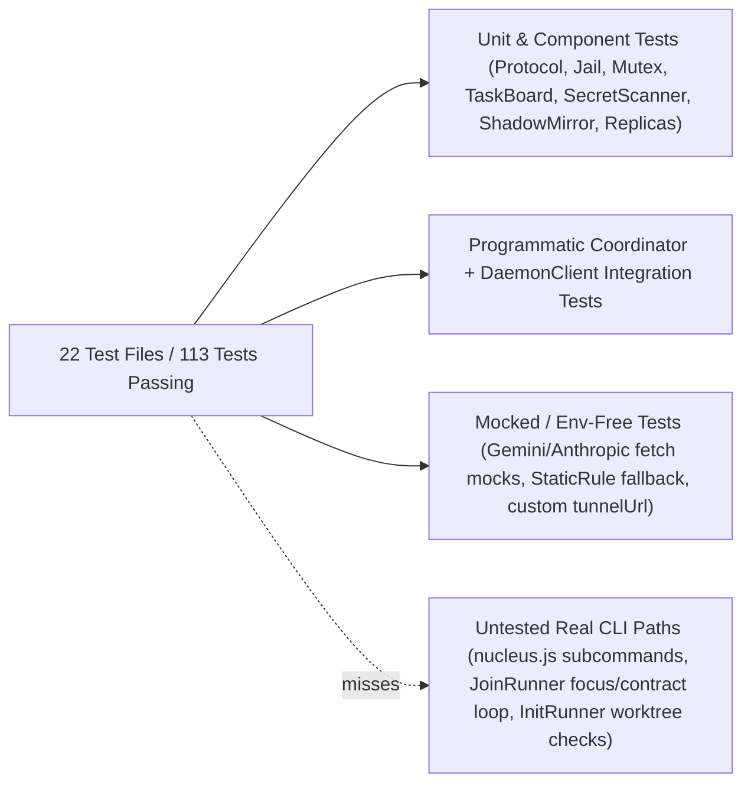

# Test Suites & Runtime Verification Audit

> **Purpose:** Honest breakdown of all **22 Vitest test files (113 tests)** currently in the repository—explaining what each suite genuinely proves, what is mocked or only tested in isolation, and why `npm test` passes 100% even though end-to-end CLI workflows still have real gaps.

---

## Live Verification Summary

Running `npm test` across the monorepo executed **22 test files and 113 tests**, all passing in **3.29s** (note: [README.md](../../README.md) still states an outdated count of `76/76`).

---

## Complete Inventory of All 22 Test Files

### 1. `@nucleus/protocol` (1 file, 8 tests)
| Test File | Tests | What It Verifies | What It Misses / Caveats |
| :--- | :---: | :--- | :--- |
| `packages/protocol/src/protocol.test.ts` | 8 | Envelope schema, contract lock max TTL rejection, task spec fields, HMAC `signEnvelope`/`verifyEnvelopeSignature`, live diff frame, hello/heartbeat/severed defaults. | Envelope signing works in unit tests, yet **neither `CoordinatorServer` nor `DaemonClient` uses it** in production. |

### 2. `@nucleus/coordinator` (10 files, 49 tests)
| Test File | Tests | What It Verifies | What It Misses / Caveats |
| :--- | :---: | :--- | :--- |
| `packages/coordinator/src/lock/mutex.test.ts` | 5 | Lock acquire, contention, renewal, release, `isExpiringSoon`, `getExpiringLocks`. | `isExpiringSoon` and `getExpiringLocks` are never called by `CoordinatorServer`. |
| `packages/coordinator/src/task/task-board.test.ts` | 10 | Revisions, optimistic concurrency, FSM transitions, immutable `assigned_node_id`, cycle/DAG validation, contract `@version` unblocking, crash-safe archival self-healing. | Tests `TaskBoardManager` & `TaskBoardReplica` directly, bypassing `JoinRunner`'s `.nucleus/tasks.json` file watcher (which omits `expected_revision`). |
| `packages/coordinator/src/server/coordinator.integration.test.ts` | 3 | WebSocket `session:hello` handshake, bad token rejection, lane mismatch rejection (`4003`). | Uses `DaemonClient` directly (not `JoinRunner`). |
| `packages/coordinator/src/server/contract-sync.integration.test.ts` | 4 | Lock acquire/deny, contract broadcast + `ContractReplica`, path traversal rejection, `ContractStore` manifest persistence across restarts. | Tests `ContractStore` at root `CONTRACT/` only (misses nested subdirectory loading bug), and doesn't test `ContractWatcher` inside `JoinRunner`. |
| `packages/coordinator/src/server/sharing.integration.test.ts` | 6 | `PeersIndexManager`, `ShadowMirror`, `WorkspaceDiffWatcher`, unauthorized message dropping, server envelope reconstruction, shadow sync/delete, catch-up shadows for late joiners. | Notice line 71 of the test copies `JoinRunner`'s bug (`updatePeerFocus(payload.lane, ...)`), and the catch-up test joins a fresh `ShadowMirror` (so it didn't catch the `version: 1` rejection on reconnecting peers with persisted manifests!). |
| `packages/coordinator/src/server/critique.integration.test.ts` | 5 | Claim/lane-mismatch/self-approve checks, `WorktreeManager` + `DeterministicRunner` + `MarkdownCritiqueFormatter`, stale `expected_revision`, distinct `display_name` ownership, failing deterministic check inside worktree rejecting `in_review` task. | **Crucial caveat:** The test manually calls `coordinator.setWorktreeManager()` and `coordinator.setDeterministicChecks()`—which `InitRunner` (`nucleus init`) **never** calls! |
| `packages/coordinator/src/server/benchmark.test.ts` | 3 | 1s lock TTL auto-recovery, 5-node contract broadcast latency (<100ms), `EventLog` JSONL entries written to disk. | Inspects `.jsonl` lines on disk without testing `CoordinatorServer` replaying them on restart (because `CoordinatorServer` doesn't call `replay()`). |
| `packages/coordinator/src/server/e2e-stress.test.ts` | 2 | 10 sequential shadow sync versions, failing deterministic check + formatted critique rejection. | Runs `WorktreeManager` and `DeterministicRunner` manually outside `CoordinatorServer`. |
| `packages/coordinator/src/server/deep-audit.test.ts` | 10 | 3-lane orchestration, 200-msg burst throughput, 5-node fanout latency, 10-node lock contention, jailbreak vectors, `SecretScanner`, bad token, malformed JSON fuzzing, stale shadow rejection, `maxClients` quota (`4029`). | Uses direct `DaemonClient`, `ContractStore`, and `ShadowMirror` calls rather than full CLI workflows. |
| `packages/coordinator/src/server/dogfooding-simulation.test.ts` | 1 | Simulates backend + frontend flow: token issue, connect, claim, lock, contract update, `PEERS.md`, shadow sync, `AICriticPipeline` approval. | Calls `board.claimTask`, `mutex.acquire`, `contractStore.update`, `ShadowMirror`, and `AICriticPipeline` manually in sequence—bypassing `JoinRunner` and `CoordinatorServer`'s review hook. |

### 3. `@nucleus/daemon` (6 files, 26 tests)
| Test File | Tests | What It Verifies | What It Misses / Caveats |
| :--- | :---: | :--- | :--- |
| `packages/daemon/src/client/daemon-reconnect.test.ts` | 3 | Exponential backoff reconnect after socket drop, offline queue buffering & flush on reconnect, rejected handshake (`4003`). | Terminates socket on the client while coordinator stays up; doesn't test **coordinator restart** (where `InviteStore` loses tokens). |
| `packages/daemon/src/contract/contract-replica.test.ts` | 1 | Applies contract updates, persists `.nucleus/contracts-manifest.json` across restart, rejects stale versions. | Does not test `ContractWatcher` at all (there are zero unit tests for `ContractWatcher`). |
| `packages/daemon/src/jail/jail.test.ts` | 6 | Blocks `../`, prefix-sibling escapes, absolute paths, and external symlinks/junctions while allowing internal symlinks. | Skips symlink assertions silently if OS permissions forbid symlink creation. |
| `packages/daemon/src/shadow/peers-index.test.ts` | 3 | Renders `.nucleus/PEERS.md` table, task spec instructions, and custom `peers.template.md` from `CONTRACT/` or `.nucleus/`. | Doesn't test `JoinRunner`'s focus-update message path (where `payload.lane` breaks `nodeId` lookup). |
| `packages/daemon/src/shadow/shadow-mirror.test.ts` | 5 | Write/read shadow files, stale version rejection, delete + empty dir cleanup, stale delete rejection, restart manifest persistence. | Uses monotonic integer versions (`1..6`), masking the `Date.now()` vs `1` mismatch in live CLI reconnects. |
| `packages/daemon/src/watcher/diff-watcher.test.ts` | 8 | Non-bypassable ignores, binary extension & null-byte checks, sensitive filenames, outbound secret suppression, unified diff create/modify/delete, >50KB diff truncation with full shadow sync, initial workspace scan. | Only tests `ignoredPatterns: []` against `GLOBAL_NON_BYPASSABLE_IGNORES` (`node_modules`, `.nucleus/shadows`), not `.nucleus/tasks.json` leakage when custom ignores are passed. |

### 4. `@nucleus/critic` (3 files, 13 tests)
| Test File | Tests | What It Verifies | What It Misses / Caveats |
| :--- | :---: | :--- | :--- |
| `packages/critic/src/reviewer/ai-critic.test.ts` | 4 | Clean diff approval, secret rejection, custom LLM provider findings, 200-word dialectic brevity guard (`pro` lane). | Relies on `StaticRuleCriticProvider` directly; doesn't verify behavior when `GEMINI_API_KEY` disables the brevity guard. |
| `packages/critic/src/reviewer/providers/providers.test.ts` | 6 | Missing key info message, mocked `fetch` parsing for Gemini and Anthropic, HTTP 403 warning handling, `AutoLLMCriticProvider` fallback without keys. | Uses mocked `fetchFn` only; doesn't test `AICriticPipeline` behavior on API failure (which erroneously yields `approved`). |
| `packages/critic/src/scanner/secret-scanner.test.ts` | 3 | AWS key detection, Stripe `sk_live_` detection, clean env-var code passing. | Only tests 2 of the 4 regexes; doesn't test `scanDirectory` or modern token formats. |

### 5. `@nucleus/cli` (2 files, 17 tests)
| Test File | Tests | What It Verifies | What It Misses / Caveats |
| :--- | :---: | :--- | :--- |
| `packages/cli/src/cli.test.ts` | 6 | `parseCli`, local `claimTaskLocally` & `archiveCompletedTasksLocally`, `InitRunner` + `JoinRunner` handshake (`PEERS.md`), `InitRunner` with mocked `tunnelUrl`, `dialectic` preset turn-taking & round-2 spawning, `brainstorm` preset scaffold. | Uses a custom `tunnelUrl` instead of spawning real `cloudflared`/`ngrok` (hiding the `resolveCloudflaredBinary()` loop bug); tests `dialectic` round spawning by calling `server.getTaskBoard().updateStatus(..., true)` directly instead of via `JoinRunner` + `tasks.json` watching; never executes `packages/cli/bin/nucleus.js` as a subprocess. |
| `packages/cli/src/system-audit.test.ts` | 11 | Cross-lane claim rejection, token node-binding hijack check, custom `tunnelUrl`, task archival, 10k path filter benchmark, 300-msg burst, 4-peer fanout latency, jailbreak strings, binary/null-byte checks, `SecretScanner`, invalid handshake `4003`. | Same pattern: tests components in isolation or with direct `DaemonClient`, leaving `bin/nucleus.js` missing `invite`/`status` handlers and `InitRunner`'s missing critic checks uncovered. |

---

## Why Tests Pass While Real Usage Has Friction

1. **Direct class wiring in tests vs. incomplete wiring in `InitRunner` & `JoinRunner`:** Integration tests manually attach `WorktreeManager`, `DeterministicRunner`, `ContractReplica`, and `DaemonClient`, whereas the real CLI commands (`init.ts`, `join.ts`, `bin/nucleus.js`) skip several of those connections.
2. **No subprocess E2E tests for `bin/nucleus.js`:** Nobody tests running `node packages/cli/bin/nucleus.js invite` or `status`, or editing `.nucleus/tasks.json` in a `JoinRunner` room to trigger an end-to-end `critique` loop back to a contributor.
3. **Mocked network & tunnel boundaries:** LLM providers are tested with fake `fetchFn` mocks and `TunnelManager` is tested with a pre-supplied `tunnelUrl`, so real binary resolution and live API error verdicts weren't caught.
